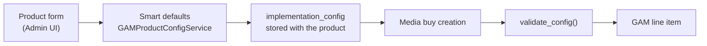
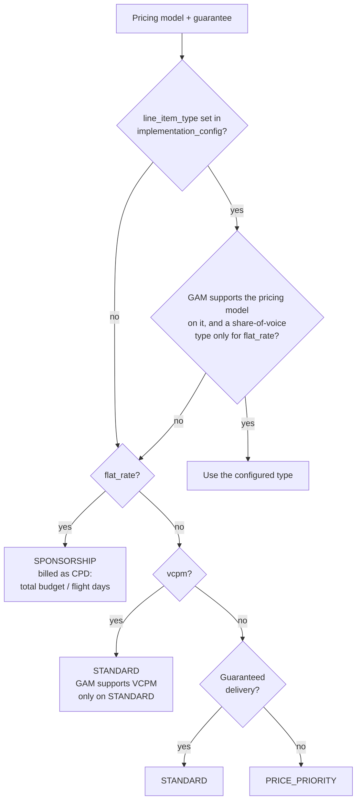

# GAM product configuration

How to configure Google Ad Manager (GAM) trafficking settings for products in the Prebid Sales Agent. The configuration system separates user-facing AdCP product fields from the internal GAM fields that line item creation requires.

## Contents

- [Overview](#overview)
- [Quick start](#quick-start)
- [Configuration workflow](#configuration-workflow)
- [Line item type selection](#line-item-type-selection)
- [Field reference](#field-reference)
- [Testing](#testing)
- [Troubleshooting](#troubleshooting)
- [API reference](#api-reference)
- [Best practices](#best-practices)
- [Related documentation](#related-documentation)

## Overview

The configuration model distinguishes three layers:

- **AdCP fields**: Price, formats, countries — visible to buyers.
- **GAM fields**: Priority, inventory targeting, creative placeholders — internal only.
- **`implementation_config`**: The JSONB column on the products table that stores all GAM-specific settings.

The following diagram shows how a product's GAM configuration flows from creation to a live line item:



For where adapters sit in the overall system, see [Architecture](../../development/architecture.md). For the adapter interface itself, see [Creating an adapter](../creating-an-adapter.md).

## Quick start

1. In the Admin UI's inventory browser, click **Sync All** to sync the GAM inventory.
2. Open the product form, as [Create a product](../../user-guide/products.md#create-a-product) describes.
3. Under **Inventory Configuration**, click **Browse Ad Units** or **Browse Placements** and select the inventory.
4. Set the pricing options. The first pricing option sets the delivery type: a fixed price is guaranteed, and an auction price is non-guaranteed.
5. Click **Create Product**. The system generates a default GAM configuration from the delivery type and the formats, and stores it with the inventory you selected.
6. Create a media buy. The adapter creates the GAM line items from the stored configuration. If a product has no configuration at media buy time, the system generates defaults then.

For the sections of the product form that are not specific to GAM, such as the pricing options and the publisher properties, see [Product form](../../user-guide/products.md#product-form).

## Configuration workflow

### Smart default generation

`GAMProductConfigService.generate_default_config()` derives defaults from the product's delivery type. Creative placeholders are derived from the product's formats.

Guaranteed products:

```json
{
  "cost_type": "CPM",
  "line_item_type": "STANDARD",
  "priority": 6,
  "primary_goal_type": "LIFETIME",
  "primary_goal_unit_type": "IMPRESSIONS",
  "delivery_rate_type": "EVENLY",
  "creative_rotation_type": "EVEN",
  "non_guaranteed_automation": "manual",
  "include_descendants": true,
  "creative_placeholders": ["..."]
}
```

Non-guaranteed products:

```json
{
  "cost_type": "CPM",
  "line_item_type": "PRICE_PRIORITY",
  "priority": 10,
  "primary_goal_type": "NONE",
  "primary_goal_unit_type": "IMPRESSIONS",
  "delivery_rate_type": "AS_FAST_AS_POSSIBLE",
  "creative_rotation_type": "OPTIMIZED",
  "non_guaranteed_automation": "confirmation_required",
  "include_descendants": true,
  "creative_placeholders": ["..."]
}
```

### GAM settings on the product form

A tenant that uses GAM gets the GAM product form. You set a product's GAM settings on that form when you create or edit the product. The form has the following GAM controls:

- **Inventory Configuration**: An inventory profile, which supplies the ad units, the placements, the creative formats, and the publisher properties, or the ad units and placements that you select with **Browse Ad Units** and **Browse Placements**. The form stores a manual selection in `targeted_ad_unit_ids` and `targeted_placement_ids`.
- **Include child ad units in targeting**: A checkbox that the form stores in `include_descendants`.
- **Custom Targeting (Optional)**: Key-value targeting that the form stores in `custom_targeting_keys`.

**Browse Ad Units** and **Browse Placements** stay inactive until you sync the GAM inventory.

To create an inventory profile, open **Settings > Inventory**, click **Browse Inventory**, and click **Create Profile** on the **Inventory Profiles** tab. The form's own **Create New** button does nothing. Known issue: [#2678](https://github.com/prebid/salesagent/issues/2678).

The **GAM Line Item Configuration** section of the form has no input. The adapter selects the line item type of each package, as [Line item type selection](#line-item-type-selection) describes, and books that type's priority, which [Priority](#priority) lists.

A product starts with the generated defaults. The form has no control for the other fields, such as `line_item_type`, `frequency_caps`, `creative_rotation_type`, and `delivery_rate_type`. When you edit a product, the form keeps the stored fields that it does not show.

### Validation

`GAMProductConfigService.validate_config()` checks the configuration when a media buy is created. It checks the following conditions:

- `priority` and `creative_placeholders` are present.
- `priority` is an integer between 1 and 16.
- Every creative placeholder has a `width` and a `height`.
- `line_item_type`, if present, is one of the valid values.

An invalid configuration fails the media buy with `VALIDATION_ERROR`. The error names the product and the failed check.

Validation passes when the configuration names no ad unit and no placement. The adapter then refuses the media buy with `PRODUCT_UNAVAILABLE`, because every GAM line item must target ad units or placements.

The product form does not run `validate_config()`. When you save a product, the form refuses ad unit IDs that are not numeric and custom targeting that GAM cannot take.

## Line item type selection

You can set `line_item_type` explicitly, but you don't have to. `PricingCompatibility.select_line_item_type()` (in `src/adapters/gam/pricing_compatibility.py`) uses a configured type when it can book the package: GAM supports the package's pricing model on it, and SPONSORSHIP, NETWORK and HOUSE are used only for flat-rate packages. Those three types take only a daily goal of a percentage of impressions, which cannot hold a CPM, vCPM or CPC package to its budget. Otherwise the type is picked from the pricing model and the delivery guarantee, as when no type is configured. A configured HOUSE is therefore never used: GAM allows only CPM on it.

The following decision tree shows how the adapter selects the line item type:



CPD (cost per day) is a GAM cost type, not an AdCP pricing model — the adapter uses it internally to translate flat-rate pricing into GAM's native flat-fee model.

## Field reference

The authoritative field list is the `GAMImplementationConfig` schema in `src/adapters/gam_implementation_config_schema.py`. The fields you set most often are described here.

### Validated fields

#### Priority

- **Field**: `priority` (required)
- **Type**: Integer, 1-16, where 1 is the highest priority
- **Stored default**: 6 for guaranteed, 10 for non-guaranteed. `generate_default_config()` stores it.
- **Booked priority**: Validation requires the field, but the adapter does not read it. Known issue: [#2374](https://github.com/prebid/salesagent/issues/2374). The adapter books each line item at the priority of its line item type: 4 for `SPONSORSHIP`, 8 for `STANDARD`, 12 for `PRICE_PRIORITY`, `BULK`, and `NETWORK`, and 16 for `HOUSE`.

#### Creative placeholders

- **Field**: `creative_placeholders` (required)
- **Type**: Array of objects
- **Structure**:

  ```json
  [
    {
      "width": 300,
      "height": 250,
      "expected_creative_count": 1,
      "is_native": false
    }
  ]
  ```

- **Auto-generated**: Derived from the product's formats

#### Line item type

- **Field**: `line_item_type` (optional)
- **Type**: String enum
- **Values**: `STANDARD`, `PRICE_PRIORITY`, `SPONSORSHIP`, `NETWORK`, `BULK`, `HOUSE`
- **Behavior**: When absent, the adapter selects the type from the pricing model — see [Line item type selection](#line-item-type-selection)

### Optional fields

#### Primary goal

- **Fields**: `primary_goal_type` (`DAILY`, `LIFETIME`, `NONE`) and `primary_goal_unit_type` (`IMPRESSIONS`, `CLICKS`, `VIEWABLE_IMPRESSIONS`)
- **Defaults**: `LIFETIME` for guaranteed, `NONE` for non-guaranteed; unit defaults to `IMPRESSIONS`
- **Behavior**: The goal type follows the line item type: `STANDARD` and `BULK` book `LIFETIME`; `SPONSORSHIP` and `NETWORK` (flat rate only) book a `DAILY` share of 100% of impressions. The configured `primary_goal_type` applies to `PRICE_PRIORITY`, which accepts `LIFETIME`, `DAILY` and `NONE` and books `LIFETIME` for any other value. CPC packages book `CLICKS` and vCPM packages `VIEWABLE_IMPRESSIONS`.
- **Units**: the package's volume, which is its budget at the price of the pricing option it selected (per thousand for CPM and vCPM). A `DAILY` goal spreads it over the flight's days.

#### Inventory targeting

- **Fields**: `targeted_ad_unit_ids`, `excluded_ad_unit_ids`, `targeted_placement_ids` (arrays of strings), `include_descendants` (boolean, default `true`)
- **Behavior**: The adapter refuses a media buy for a product that has neither ad units nor placements. GAM requires numeric IDs.

#### Frequency caps

- **Field**: `frequency_caps`
- **Type**: Array of objects
- **Structure**:

  ```json
  [
    {
      "max_impressions": 3,
      "time_unit": "DAY",
      "time_range": 1
    }
  ]
  ```

- **Time units**: `MINUTE`, `HOUR`, `DAY`, `WEEK`, `MONTH`, `LIFETIME`

#### Creative rotation

- **Field**: `creative_rotation_type`
- **Values**: `EVEN`, `OPTIMIZED`, `MANUAL`, `SEQUENTIAL`
- **Defaults**: `EVEN` for guaranteed, `OPTIMIZED` for non-guaranteed

#### Delivery rate

- **Field**: `delivery_rate_type`
- **Values**: `EVENLY`, `FRONTLOADED`, `AS_FAST_AS_POSSIBLE`
- **Defaults**: `EVENLY` for guaranteed, `AS_FAST_AS_POSSIBLE` for non-guaranteed

#### Custom targeting

- **Field**: `custom_targeting_keys`
- **Type**: JSON object in the groups format the product form's targeting widget saves
- **Behavior**: Criteria within a group are ANDed and groups are ORed. Every line item for the product must match this targeting AND any custom targeting in the buyer's request.
- **Example**: `(11001 is 448512 or 448513, and 11002 is not 448601) or (11003 is 448701)`

  ```json
  {
    "groups": [
      {
        "criteria": [
          {"keyId": "11001", "values": ["448512", "448513"]},
          {"keyId": "11002", "values": ["448601"], "exclude": true}
        ]
      },
      {
        "criteria": [{"keyId": "11003", "values": ["448701"]}]
      }
    ]
  }
  ```

  `keyId` is a numeric GAM custom targeting key ID. Each value is a numeric GAM value ID, or a value name, which is looked up in GAM and created if it does not exist. A value written `{"name": "..."}` is always a name, even when it is all digits.
  Two older formats are still read. In `{"<key_id>": "<value_name>"}` a `NOT_<key_id>` key excludes the value, and the value is always a name, even when it is all digits. `{"include": {"<key_id>": [values]}, "exclude": {...}, "operator": "AND"}` reads values the way the groups format does. The edit page shows a product stored in either one in the groups format, with a name of digits written `{"name": "..."}`, and saving stores the groups format.
  A criterion with no values and a group with no criteria are ignored. Anything else GAM cannot take, such as a key that is not a numeric key ID or a field none of the formats has, is refused when the product is saved. A product already stored that way refuses every media buy with `CONFIGURATION_ERROR`; its edit page says so and keeps the stored targeting until new targeting is set.

#### Non-guaranteed automation

- **Field**: `non_guaranteed_automation`
- **Values**: `automatic` (instant activation), `confirmation_required` (human approval, then automatic activation), `manual` (a human handles all steps)
- **Defaults**: `manual` for guaranteed, `confirmation_required` for non-guaranteed

## Testing

### Test the product form

```bash
# Start Docker services
docker compose up -d

# Open the Admin UI
open http://localhost:8000
```

In the Admin UI of a GAM tenant, open the product form. Exercise the inventory selection, the custom targeting, and the checks the form runs when you save.

### Verify the stored configuration

Through the database:

```sql
SELECT
  product_id,
  name,
  delivery_type,
  implementation_config->>'line_item_type' as line_item_type,
  implementation_config->>'priority' as priority
FROM products
WHERE implementation_config IS NOT NULL;
```

Through the Admin UI:

1. On the products page, click **Edit** for the product.
2. Verify that the form shows the stored inventory and custom targeting.
3. Change the inventory selection.
4. Click **Update Product**.
5. Open the product again and confirm that the change persists.

### Test media buy creation

- With a valid configuration: create a media buy for the product. It succeeds and creates a GAM line item.
- With an invalid configuration: remove a required field from `implementation_config` and attempt to create a media buy. It fails with an explicit validation error.

For the automated end-to-end stack, see [E2E testing](../../development/e2e-testing.md). For real-GAM manual tests, see [Testing setup](testing-setup.md).

## Troubleshooting

### "Product ... has invalid GAM configuration"

- **Cause**: `validate_config()` rejects the product's stored `implementation_config` at media buy creation. The message ends with the reason, for example `Missing required GAM field: priority`.
- **Fix**: The Admin UI cannot correct these fields on an existing product. The product form has no control for `priority`, `line_item_type`, or `creative_placeholders`, and saving the form keeps their stored values. A product created with the form starts with valid values for all three.

### Inventory picker not loading

- **Cause**: No inventory has been synced for the tenant.
- **Fix**: Run an inventory sync from the Admin UI's inventory browser (**Sync All**).

## API reference

### GAM configuration service

```python
from src.services.gam_product_config_service import GAMProductConfigService

service = GAMProductConfigService()

# Generate defaults
config = service.generate_default_config(
    delivery_type="guaranteed",
    formats=["display_300x250"],
)

# Validate a config
is_valid, error_msg = service.validate_config(config)
```

### Inventory list endpoint

```http
GET /api/tenant/{tenant_id}/inventory-list
  ?type=ad_unit
  &search=sports
  &status=ACTIVE
```

Query parameters:

- `type`: `ad_unit` or `placement`; omit for both.
- `search`: Case-insensitive partial match on the name.
- `status`: Defaults to `ACTIVE`; use `ALL` for all statuses.
- `ids`: Comma-separated inventory IDs to fetch directly, bypassing the result limit.

Response:

```json
{
  "items": [
    {
      "id": "123456",
      "name": "Sports Homepage",
      "path": ["Sports", "Homepage"],
      "type": "ad_unit",
      "status": "ACTIVE"
    }
  ],
  "count": 1,
  "has_more": false
}
```

## Best practices

### Inventory targeting

- Specify ad units or placements for every product. The adapter refuses a media buy for a product without them.
- Use placements for grouped inventory.
- Use ad units with `include_descendants` for hierarchies.
- Test targeting in GAM before production.

### Creative placeholders

- Match the product's formats exactly.
- Set `expected_creative_count` to the number of creatives you expect per size.
- Set `is_native: true` for native formats.

### Frequency caps

- Set reasonable caps (3-5 per day is typical).
- Use `LIFETIME` caps for awareness campaigns.
- Test the impact on delivery before production, and monitor fill rate after enabling caps.

## Related documentation

- [GAM adapter overview](README.md) — supported features and pricing model mapping
- [Testing setup](testing-setup.md) — real-GAM manual test configuration
- [Creating an adapter](../creating-an-adapter.md) — the adapter interface this configuration feeds
- [Architecture](../../development/architecture.md) — where adapters sit in the system
- [E2E testing](../../development/e2e-testing.md) — the automated test stack
