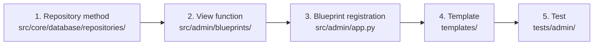

# Add an Admin UI page

This page shows how to add a page, or a route that a page calls, to the Flask admin
application. The files to copy are `src/admin/blueprints/accounts.py` and
`src/admin/blueprints/signing_keys.py`, and this page follows them. Many other blueprints
carry debt, and [Patterns you must not copy](#patterns-you-must-not-copy) lists what to
avoid in them.

Read [Admin UI architecture](admin-ui-architecture.md) first if you do not know where the
admin application sits in the process.

## The parts of a page

A page is five pieces of code. The following diagram shows them in dependency order: each
piece builds on the one before it.



Follow the test-driven cycle of the repository: write the failing test first, and then the
code that makes it pass. The sections of this page are in dependency order, not in the order
you type them.

## Add the data access

Open no database session and run no query in a view. Open a Unit of Work for the tenant
instead, and call a repository method.

1. Find the repository for your data in `src/core/database/repositories/`.
1. If the repository lacks the read or write you need, add a method to it. Do not reach for
   `uow.session`.
1. Find the Unit of Work class that carries the repository in
   `src/core/database/repositories/uow.py`. Add a class only when no class carries your
   repository.

[Patterns reference](patterns-reference.md) shows both patterns with examples and explains
how to add a repository.

## Write the view

Add the view to the blueprint that owns the area. Create a blueprint module only for an
area that has none.

The following view is the list page of `signing_keys.py`, shortened to leave out the
imports and the docstring:

```python
signing_keys_bp = Blueprint("signing_keys", __name__)


@signing_keys_bp.route("/")
@require_tenant_access()
def list_signing_keys(tenant_id: str) -> ResponseReturnValue:
    now = datetime.now(UTC)
    with SigningKeyUoW(tenant_id) as uow:
        assert uow.signing_keys is not None
        published = uow.signing_keys.publishable_at(now=now, grace_seconds=get_settings().signing.grace_seconds)
        active = uow.signing_keys.active_at(now=now)
        # Rendered inside the session context to avoid DetachedInstanceError.
        return render_template(
            "signing_keys_list.html",
            tenant_id=tenant_id,
            keys=published,
            active_kid=active.kid if active else None,
            algorithms=SIGNING_ALG_VALUES,
        )
```

The following view handles a form in the same module. This shortened copy leaves out the
docstring and the comments:

```python
@signing_keys_bp.route("/create", methods=["POST"])
@require_tenant_access()
@log_admin_action("provision_signing_key")
def create_signing_key(tenant_id: str) -> ResponseReturnValue:
    alg = request.form.get("alg", "").strip()

    try:
        with SigningKeyUoW(tenant_id) as uow:
            assert uow.signing_keys is not None
            kid = provision_signing_key(uow.signing_keys, tenant_id=tenant_id, alg=alg)
    except AdCPConfigurationError as exc:
        tracked_by = exc.details.tracked_by if exc.details is not None else None
        flash(
            f"Could not provision a signing key: {exc}" + (f" {tracked_by}" if tracked_by else ""),
            "error",
        )
        return redirect(url_for("signing_keys.list_signing_keys", tenant_id=tenant_id))

    flash(f"Signing key {kid} provisioned and published.", "success")
    return redirect(url_for("signing_keys.list_signing_keys", tenant_id=tenant_id))
```

The following sections state the rules for a view.

### Order the decorators

Put the decorators in this order, from the top:

1. The route decorator
1. The access check
1. The audit decorator, on a route that changes state

Give every route whose URL has a `tenant_id` the `require_tenant_access()` decorator. The
decorator passes `tenant_id` to the view as its first argument, so make it the first
parameter. Pass `role=UserRole.ADMIN` on a route that only a tenant admin may use. Pass
`api_mode=True` on a route that a script calls, so that a refusal is a JSON body and not a
redirect. [Admin UI authentication and permissions](admin-ui-authentication.md#access-checks)
lists the other checks.

Give every route that changes state `log_admin_action("<operation>")`, under the access
check. Give a read-only route no audit decorator. Name the operation after the action, in
snake case, for example `create_account`. The decorator writes a row for every call, so a
route that serves both `GET` and `POST` also audits each `GET`.

### Annotate the view

Annotate the parameters and the return type. Use `flask.typing.ResponseReturnValue` for the
return type. `make quality` also runs mypy with `--check-untyped-defs` over `src/` and fails
when the number of errors rises. An unannotated view hides its body from the normal mypy
run. The views in `accounts.py` carry no annotations, which is debt.

In an annotated view, mypy checks the body. A Unit of Work types each repository attribute
as optional, so assert that the attribute is not `None` before you use it, as
`signing_keys.py` does.

### Read and check the input

Read form fields with `request.form.get("<name>", "").strip()`. Read a JSON body with
`request.get_json(silent=True) or {}`.

Check the input in the view before you open the Unit of Work. For a form, flash the problem
and redirect back to the form:

```python
if not name:
    flash("Account name is required.", "error")
    return redirect(request.url)
```

When a field holds a URL that the application later calls, check it with the helpers in
`src/admin/utils/url_policy.py`. Do not write your own address check. See
[Outbound egress](../security/outbound-egress.md).

### Keep the work out of the view

Let the view validate the input, call the code that does the work, and answer. Put the work
in one of the following places:

- A repository method, for a read or a simple write
- A service function, when the work has rules of its own. `create_signing_key` calls
  `provision_signing_key`, and it contains no provisioning logic itself.

Do not build a database row from raw keyword arguments in the view. Ask the repository to
build it, as `create_account` does with `AccountRepository.build_row`.

Render the template inside the `with` block when the template reads the rows. When the
block exits, the Unit of Work commits and closes its session. The commit expires every
attribute, so reading any attribute of a row outside the block raises
`DetachedInstanceError`.

### Answer the browser

A page route answers in one of two ways:

- After a successful change, flash a message and redirect to a page with
  `url_for("<blueprint>.<function>", tenant_id=tenant_id)`. The two model blueprints never
  render a page in answer to a `POST`.
- After a refusal, flash the reason with the category `error` and redirect.

The flash categories are `success`, `error`, `warning`, and `info`. `base.html` draws them.

A flash message travels in the session cookie, which is signed and not encrypted. Never
flash a secret, a token, or key material.

Catch only the refusal you expect, by its type. In `create_account`, that is the
repository's `ValueError` for a duplicate. Let every other exception rise.

When a view catches a refusal and redirects, the audit decorator sees a normal return and
records a success. Call `record_admin_action_failure(error)` from
`src/admin/utils/audit_decorator.py` in that branch, so that the audit row records the
failure. The refusal branches of `create_account` and `create_signing_key` do not call it,
which is debt.

### Answer a script

A route that a page script calls returns JSON with a status code. Use the shape that
`accounts.change_status` uses:

```python
return jsonify({"success": False, "error": "Account not found."}), 404
...
return jsonify({"success": True, "status": new_status})
```

Never put the text of an unexpected exception into a response. For an unexpected database
error, use `safe_error_message(e)` from `src/admin/utils/operator_errors.py`. It replaces the
text of a `SQLAlchemyError` with a fixed sentence and logs the detail. For any other
exception, it returns `str(e)` unchanged, so catch only the refusals whose text you mean to
show.

## Register the blueprint

Skip this section when you add a route to a blueprint that is already registered.

For a blueprint module that you create, make two changes to `src/admin/app.py`. Import the
blueprint at the top of the module, and add one `app.register_blueprint(...)` line to
`create_app` that gives the prefix:

```python
# At the top of src/admin/app.py:
from src.admin.blueprints.accounts import accounts_bp

# In create_app, with the other blueprints:
app.register_blueprint(accounts_bp, url_prefix="/tenant/<tenant_id>/accounts")
```

With `<tenant_id>` in the prefix, every route of the blueprint receives `tenant_id`.

Before you choose a path, search for it in the
[Admin UI route reference](admin-ui-routes.md). The route-conflict check fails when two URL
rules with the same rule string share an HTTP method other than `HEAD` or `OPTIONS`. It
compares rule strings, so it misses two rules that spell one path differently, such as
`/<id>` and `/<item_id>`.

## Write the template

Add the template to `templates/`. Extend the base template and fill its blocks. The
following template is `templates/accounts_list.html`, shortened to its header:

```html

Accounts - {{ tenant_id }}

<div class="accounts-header">
    <h2>Accounts</h2>
    <a href="{{ url_for('accounts.create_account', tenant_id=tenant_id) }}" class="btn btn-primary">
        <i class="fas fa-plus"></i> New Account
    </a>
</div>

```

`base.html` defines the blocks `title`, `content`, and `scripts`. It has no `head` block.

### Build every URL from the application

The Admin UI runs under the `/admin` prefix. A URL that starts with `/` drops that prefix.
The request then reaches the Flask application through the root mount, unless a FastAPI
route claims the path first, such as `GET /`. Follow these two rules:

- In HTML, build links and form actions with `url_for`.
- In a script, prefix the path with `request.script_root`.

The following block is the script of `templates/account_detail.html`:

```html

<script>
const scriptRoot = '{{ request.script_root }}' || '';
function changeStatus(newStatus) {
    if (!confirm('Change account status to "' + newStatus + '"?')) return;
    fetch(scriptRoot + '/tenant/{{ tenant_id }}/accounts/{{ account.account_id }}/status', {
        method: 'POST',
        headers: { 'Content-Type': 'application/json' },
        credentials: 'same-origin',
        body: JSON.stringify({ status: newStatus })
    })
    .then(r => r.json())
    .then(data => {
        if (data.success) { window.location.reload(); }
        else { alert(data.error || 'Failed to change status'); }
    })
    .catch(err => alert('Error: ' + err));
}
</script>

```

`make quality` runs `.pre-commit-hooks/check_hardcoded_urls.py` over the `.html` and `.js`
files in `templates/` and `static/`. The check fails on the following script forms:

- `window.location.href` set to a string that starts with `/auth/` or `/tenant/`
- `fetch()` called with a string that starts with `/api/`
- A `const`, `let`, or `var` assigned a string that starts with `/auth/`, `/api/`, or
  `/tenant/`

The check does not read an HTML `href` or `action` attribute, or a `fetch()` of an `/auth/`
or `/tenant/` path. Check those yourself.

### Link the page

A page that nothing links to is reachable only by its URL. Add a link from the page that
leads to yours. Use the navigation of `templates/tenant_settings.html`, the **Operations**
panel of `templates/tenant_dashboard.html`, or the list page of the area.

## Test the page

Put the test in `tests/admin/`. A test runs the real application against PostgreSQL:

- Use the `admin_client` fixture from `tests/admin/conftest.py`.
- Sign in with `admin_auth_session` from `tests/helpers/admin_session.py`.
- Create rows with the factories in `tests/factories/`. Never call `session.add()` or
  `get_db_session()` in a test.

`tests/admin/README.md` has a complete example and the commands that run the suite.

Cover at least the following cases:

- The page renders for a signed-in user of the tenant.
- A request with no session is refused.
- A valid form changes the data, and the response redirects.
- Each refusal that the view catches leaves the data unchanged.

For a feature that an operator journey describes, also write an admin BDD scenario. See
[Admin UI BDD pattern](admin-bdd-pattern.md).

## Run the checks

Run the following commands before you commit.

```bash
# Regenerate the route reference after you add, move, or remove a route,
# or change its decorators. make quality fails while the reference is stale.
uv run python scripts/generate_admin_route_reference.py

# Check formatting, lint, type-check, and run the unit tests and the guards.
make quality

# Run the tests of your module. For a path under tests/admin/, the script
# starts the full Docker test stack, or reuses one that is running.
scripts/run-test.sh tests/admin/test_<your_module>.py -x
```

`make quality` runs the following checks on admin code, among others. Each item says what
makes the check fail.

- `check_route_conflicts.py`: Two URL rules with the same rule string share an HTTP method
  other than `HEAD` or `OPTIONS`.
- `check_hardcoded_urls.py`: A script uses one of the forms that
  [Build every URL from the application](#build-every-url-from-the-application) lists.
- `check_admin_raw_session_count.py`: Admin code calls `get_db_session()` or `session.add()`
  more often than the baseline records.
- `test_architecture_admin_templates_exist.py`: A `render_template` call under `src/admin/`
  names a template that does not exist.
- `test_architecture_repository_pattern.py`: Either a function in `src/core/tools/`,
  `src/core/helpers/`, `src/core/context_manager.py`, or `src/admin/blueprints/creatives.py`
  calls `get_db_session()`, or a test body calls `session.add()` or `get_db_session()`
  outside the allowlist. The guard does not read the other admin modules.
- `test_architecture_no_raw_select.py`: Code under `src/`, outside a repository, runs
  `select()` on a model in a function that the allowlist does not name.

`tests/integration/test_template_url_validation.py` checks that every `url_for` in a
template names a view that exists. It runs with the integration suite.

## Patterns you must not copy

The admin code contains the following patterns. Each one is debt, so do not add another
instance.

- Instead of `with get_db_session() as session:` in a view, use a Unit of Work and a
  repository method.
- Instead of `select(Model)` in a view, use a repository method.
- Instead of `uow.session` in a blueprint module, add a repository method.
- Instead of `Model(...)` built from form fields in a view, use a repository method that
  builds the row.
- Instead of `require_auth()` on a URL with a `tenant_id`, use `require_tenant_access()`.
- Instead of a comparison of `session["role"]` or `session["tenant_id"]` in a view, use
  `require_tenant_access()`, with `role=UserRole.ADMIN` for an admin-only route.
- Instead of `log_admin_action` above the access check, place it under the access check.
- Instead of a state-changing route without `log_admin_action`, add the decorator.
- Instead of `except Exception` around a whole view, catch the one refusal you expect.
- Instead of `str(e)` from a broad `except` in a response body, use
  `safe_error_message(e)`.
- Instead of a test module that builds its own application, use the `admin_client` fixture.

Checks track only part of this debt. `.admin-raw-session-baseline` counts the
`get_db_session()` and `session.add()` calls. The allowlist of
`test_architecture_no_raw_select.py` lists the raw `select()` calls.
`test_guards_no_raw_exception_in_admin_response.py` checks only the modules that it lists
for raw exception text. No check tracks the other patterns, so look for them in review.

## Related documentation

- [Admin UI architecture](admin-ui-architecture.md) is the map of the admin application.
- [Admin UI authentication and permissions](admin-ui-authentication.md) describes the access
  checks.
- [Patterns reference](patterns-reference.md) covers repositories and the Unit of Work.
- [Engineering standards](engineering-standards.md) lists the standards every change meets.
