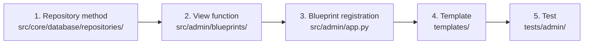

# Add an Admin UI page

This page shows how to add a page, or a route that a page calls, to the Flask admin
application. It follows the two blueprints that the rest of the admin code is converging
on: `src/admin/blueprints/accounts.py` and `src/admin/blueprints/signing_keys.py`. Copy
those two files. Many other blueprints carry tracked debt, and
[Patterns you must not copy](#patterns-you-must-not-copy) lists what to avoid in them.

Read [Admin UI architecture](admin-ui-architecture.md) first if you do not know where the
admin application sits in the process.

## The parts of a page

A page is five pieces of code. The following diagram shows them and the order to write them
in.



Follow the test-driven cycle of the repository: write the failing test first, and then the
code that makes it pass. The sections of this page are in dependency order, not in the order
you type them.

## Add the data access

A view never opens a database session and never runs a query. It opens a Unit of Work for
the tenant and calls a repository method.

1. Find the repository for your data in `src/core/database/repositories/`.
1. If the repository lacks the read or write you need, add a method to it. Do not reach for
   `uow.session`.
1. Find the Unit of Work class that carries the repository in
   `src/core/database/repositories/uow.py`. Add a class only when no class carries your
   repository.

[Patterns reference](patterns-reference.md) shows both patterns with examples and explains
how to add a repository.

## Write the view

Add the view to the blueprint that owns the area. Create a blueprint module only for an
area that has none.

The following view is the list page of `signing_keys.py`, shortened:

```python
signing_keys_bp = Blueprint("signing_keys", __name__)


@signing_keys_bp.route("/")
@require_tenant_access()
def list_signing_keys(tenant_id: str) -> ResponseReturnValue:
    now = datetime.now(UTC)
    with SigningKeyUoW(tenant_id) as uow:
        keys = uow.signing_keys.publishable_at(now=now, grace_seconds=...)
        # Rendered inside the session context to avoid DetachedInstanceError.
        return render_template("signing_keys_list.html", tenant_id=tenant_id, keys=keys)
```

The following view handles a form in the same module:

```python
@signing_keys_bp.route("/create", methods=["POST"])
@require_tenant_access()
@log_admin_action("provision_signing_key")
def create_signing_key(tenant_id: str) -> ResponseReturnValue:
    alg = request.form.get("alg", "").strip()

    try:
        with SigningKeyUoW(tenant_id) as uow:
            kid = provision_signing_key(uow.signing_keys, tenant_id=tenant_id, alg=alg)
    except AdCPConfigurationError as exc:
        flash(f"Could not provision a signing key: {exc}", "error")
        return redirect(url_for("signing_keys.list_signing_keys", tenant_id=tenant_id))

    flash(f"Signing key {kid} provisioned and published.", "success")
    return redirect(url_for("signing_keys.list_signing_keys", tenant_id=tenant_id))
```

The rules that these two views follow are in the next sections.

### Order the decorators

Put the decorators in this order, from the top:

1. The route decorator
1. The access check
1. The audit decorator, on a route that changes state

Every route whose URL has a `tenant_id` carries `require_tenant_access()`. The view then
takes `tenant_id` as its first parameter. Pass `role=UserRole.ADMIN` on a route that only a
tenant admin may use. Pass `api_mode=True` on a route that a script calls, so that a refusal
is a JSON body and not a redirect.
[Admin UI authentication and permissions](admin-ui-authentication.md#access-checks) lists
the other checks.

Every route that changes state carries `log_admin_action("<operation>")` under the access
check. A read-only route carries no audit decorator. Name the operation after the action,
in snake case, for example `create_account`.

### Annotate the view

Annotate the parameters and the return type. Use `flask.typing.ResponseReturnValue` for the
return type. `make quality` also runs mypy with `--check-untyped-defs` over `src/` and fails
when the number of errors rises. An unannotated view hides its body from the normal mypy
run.

### Read and check the input

Read form fields with `request.form.get("<name>", "").strip()`. Read a JSON body with
`request.get_json(silent=True) or {}`.

Check the input in the view before you open the Unit of Work. For a form, flash the problem
and redirect back to the form:

```python
if not name:
    flash("Account name is required.", "error")
    return redirect(request.url)
```

When a field holds a URL that the application later calls, check it with the helpers in
`src/admin/utils/url_policy.py`. Do not write your own address check. See
[Outbound egress](../security/outbound-egress.md).

### Keep the work out of the view

The view validates, calls, and answers. The work belongs to one of the following:

- A repository method, for a read or a simple write
- A service function, when the work has rules of its own. `create_signing_key` calls
  `provision_signing_key`, and it contains no provisioning logic itself.

Do not build a database row from raw keyword arguments in the view. Ask the repository to
build it, as `create_account` does with `AccountRepository.build_row`.

Render the template inside the `with` block when the template reads the rows. Outside the
block, the rows are detached from the session, and a lazy attribute raises
`DetachedInstanceError`.

### Answer the browser

A page route answers in one of two ways:

- After a successful change, flash a message and redirect to a page with
  `url_for("<blueprint>.<function>", tenant_id=tenant_id)`. The two model blueprints never
  render a page in answer to a `POST`.
- After a refusal, flash the reason with the category `error` and redirect.

The flash categories are `success`, `error`, `warning`, and `info`. `base.html` draws them.

A flash message travels in the session cookie, which is signed and not encrypted. Never
flash a secret, a token, or key material.

Catch only the refusal you expect, by its type. In `create_account`, that is the
repository's `ValueError` for a duplicate. Let every other exception rise.

When a view catches a refusal and redirects, the audit decorator sees a normal return and
records a success. Call `record_admin_action_failure(error)` from
`src/admin/utils/audit_decorator.py` in that branch, so that the audit row records the
failure.

### Answer a script

A route that a page script calls returns JSON with a status code. Use the shape that
`accounts.change_status` uses:

```python
return jsonify({"success": False, "error": "Account not found."}), 404
...
return jsonify({"success": True, "status": new_status})
```

Never put the text of an exception into a response. For an unexpected error, use
`safe_error_message(e)` from `src/admin/utils/operator_errors.py`, which replaces database
error text with a fixed sentence and logs the detail.

## Register the blueprint

Skip this section when you add a route to a blueprint that is already registered.

For a blueprint module that you create, add one `app.register_blueprint(...)` line to
`create_app` in `src/admin/app.py`, and give the prefix there:

```python
app.register_blueprint(accounts_bp, url_prefix="/tenant/<tenant_id>/accounts")
```

With `<tenant_id>` in the prefix, every route of the blueprint receives `tenant_id`.

Before you choose a path, search for it in the
[Admin UI route reference](admin-ui-routes.md). Two views that claim one path and method
fail the route-conflict check.

## Write the template

Add the template to `templates/`. Extend the base template and fill its blocks:

```html

Accounts - {{ tenant_id }}

<div class="accounts-header">
    <h2>Accounts</h2>
    <a href="{{ url_for('accounts.create_account', tenant_id=tenant_id) }}" class="btn btn-primary">
        New Account
    </a>
</div>

```

`base.html` has three blocks: `title`, `content`, and `scripts`. It has no `head` block.

### Build every URL from the application

The Admin UI runs under a path prefix such as `/admin`, so a URL that starts with `/` breaks
behind the proxy. Follow these two rules:

- In HTML, build links and form actions with `url_for`.
- In a script, prefix the path with `request.script_root`:

```html

<script>
const scriptRoot = '{{ request.script_root }}' || '';
fetch(scriptRoot + '/tenant/{{ tenant_id }}/accounts/{{ account.account_id }}/status', {
    method: 'POST',
    headers: { 'Content-Type': 'application/json' },
    credentials: 'same-origin',
    body: JSON.stringify({ status: newStatus })
});
</script>

```

`.pre-commit-hooks/check_hardcoded_urls.py` scans the templates and the static scripts. It
fails on the common forms of a root-relative URL to `/api`, `/auth`, or `/tenant`.

### Link the page

A page that nothing links to is reachable only by its URL. Add a link from the page that
leads to yours: the navigation of `templates/tenant_settings.html`, the **Operations** panel
of `templates/tenant_dashboard.html`, or the list page of the area.

## Test the page

Put the test in `tests/admin/`. A test runs the real application against PostgreSQL:

- Use the `admin_client` fixture from `tests/admin/conftest.py`.
- Sign in with `admin_auth_session` from `tests/helpers/admin_session.py`.
- Create rows with the factories in `tests/factories/`. Never call `session.add()` or
  `get_db_session()` in a test.

`tests/admin/README.md` has a complete example and the commands that run the suite.

Cover at least the following cases:

- The page renders for a signed-in user of the tenant.
- A request with no session is refused.
- A valid form changes the data, and the response redirects.
- Each refusal that the view catches leaves the data unchanged.

For a feature that an operator journey describes, also write an admin BDD scenario. See
[Admin UI BDD pattern](admin-bdd-pattern.md).

## Run the checks

Run the following commands before you commit.

```bash
# Regenerate the route reference after you add, move, or remove a route.
uv run python scripts/generate_admin_route_reference.py

# Format, lint, type-check, and run the unit tests and the guards.
make quality

# Run the tests of your module against PostgreSQL.
scripts/run-test.sh tests/admin/test_<your_module>.py -x
```

`make quality` includes the checks that most often catch an admin change. The following
list shows what makes each one fail.

- `check_route_conflicts.py`: Two views claim one path and method.
- `check_hardcoded_urls.py`: A template or script has a root-relative URL.
- `check_admin_raw_session_count.py`: Admin code calls `get_db_session()` or `session.add()`
  more often than the baseline records.
- `test_architecture_admin_templates_exist.py`: A view renders a template that does not
  exist.
- `test_architecture_repository_pattern.py`: Code outside a repository opens a session.
- `test_architecture_no_raw_select.py`: Code outside a repository runs `select()` on a
  model.

`tests/integration/test_template_url_validation.py` checks that every `url_for` in a
template names a view that exists. It runs with the integration suite.

## Patterns you must not copy

The following patterns are in the admin code. Each one is debt that an allowlist or a
baseline tracks. Do not add another instance.

- Instead of `with get_db_session() as session:` in a view, use a Unit of Work and a
  repository method.
- Instead of `select(Model)` in a view, use a repository method.
- Instead of `Model(...)` built from form fields in a view, use a repository method that
  builds the row.
- Instead of `require_auth()` on a URL with a `tenant_id`, use `require_tenant_access()`.
- Instead of a comparison of `session["role"]` or `session["tenant_id"]` in a view, use
  `require_tenant_access()`, with `role=UserRole.ADMIN` for an admin-only route.
- Instead of `log_admin_action` above the access check, place it under the access check.
- Instead of `except Exception` around a whole view, catch the one refusal you expect.
- Instead of `str(e)` in a response body, use `safe_error_message(e)`.
- Instead of `fetch('/api/...')` in a script, use `fetch(scriptRoot + '/api/...')`.
- Instead of a test module that builds its own application, use the `admin_client` fixture.

## Related documentation

- [Admin UI architecture](admin-ui-architecture.md) is the map of the admin application.
- [Admin UI authentication and permissions](admin-ui-authentication.md) describes the access
  checks.
- [Patterns reference](patterns-reference.md) covers repositories and the Unit of Work.
- [Engineering standards](engineering-standards.md) lists the standards every change meets.
