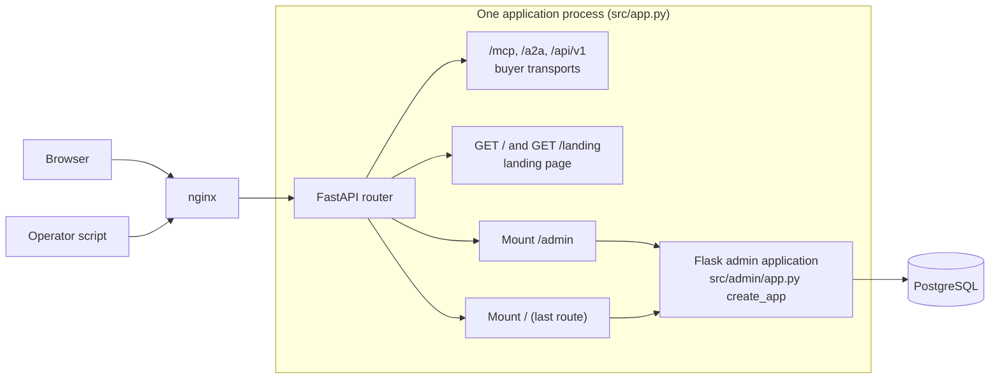
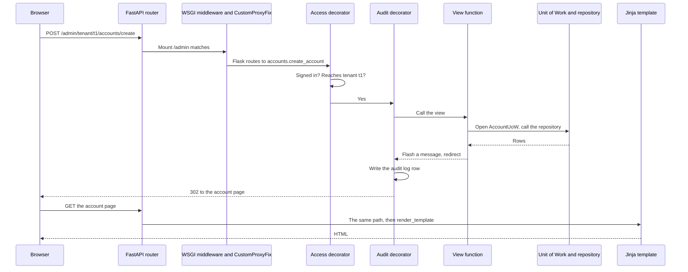

# Admin UI architecture

The Admin UI is a Flask application that publishers and operators use in a browser. It
configures tenants, products, advertisers, and ad server connections, and it is where a
person approves media buys and creatives. This page is the map of that application: where it
runs, how a request reaches a view, and where each kind of code lives.

The [Architecture guide](architecture.md) maps the whole system. This page goes one level
deeper into the box that the guide labels "Flask admin UI".

## Where the Admin UI runs

One process serves the buyer-facing transports and the Admin UI. `src/app.py` builds a
FastAPI application, creates the Flask application with `create_app`, wraps it in
`a2wsgi.WSGIMiddleware`, and mounts it twice.



The two mounts have different jobs:

- **`/admin`** is the address of the Admin UI. A browser opens `/admin/login`,
  `/admin/tenant/<tenant_id>`, and so on.
- **`/`** is a catch-all. FastAPI tries its own routes first, so the Flask application
  receives only the paths that nothing else matched. The sign-in callbacks, the
  `/tenant/<tenant_id>/...` pages, and the two operator APIs are reachable this way.

`_install_admin_mounts` in `src/app.py` moves both mounts to the end of the route list when
the application starts. That keeps the catch-all behind every FastAPI route.

`src/admin/server.py` is a second entry point that serves the Flask application alone. It
picks Waitress, Werkzeug, or Uvicorn from the `ADMIN_SERVER_TYPE` setting. The unified
process in `src/app.py` is the one the container runs.

[Request lifecycle](request-lifecycle.md#one-process-four-entry-points) describes the entry
points of the process and what the proxy does.

### How the application knows its URL prefix

A page under `/admin` must build links that start with `/admin`. Flask builds links from
`SCRIPT_NAME`, which reaches the application in two ways:

- The `/admin` mount passes its path as the ASGI `root_path`, and `a2wsgi` copies it to
  `SCRIPT_NAME`.
- `CustomProxyFix` in `src/admin/app.py` reads the `X-Script-Name` or `X-Forwarded-Prefix`
  header that a proxy sets. It moves the prefix from the path to `SCRIPT_NAME`, and adds the
  prefix to relative redirect targets.

Code must never write `/admin` or a root-relative path into a link. A template uses
`url_for`, and a script in a page uses `request.script_root`.
[Add an Admin UI page](admin-ui-add-a-page.md#write-the-template) shows both.

## What `create_app` builds

`create_app(config=None, settings=None)` in `src/admin/app.py` is the factory. It does the
following, in order:

1. It loads the settings, or takes the settings object that `src/app.py` already loaded.
1. It creates the Flask application with the repository's `templates/` and `static/`
   directories.
1. It sets the secret key and the session cookie options.
   [Session cookie configuration](../security.md#session-cookie-configuration) lists them.
1. It registers the Jinja filters `from_json` and `markdown`.
1. It wraps the application in the proxy middleware. Production adds Werkzeug's `ProxyFix`
   and a middleware that maps the Fly.io forwarding headers.
1. It registers the cross-site request check of `src/admin/csrf.py` as a `before_request`
   hook.
1. It calls `init_oauth` to register the deployment's OAuth client.
1. It creates an in-memory cache, `app.cache`, with a five-minute default lifetime.
1. It registers the context processor `inject_context`. Every template receives
   `script_name`, `support_email`, and `tenant`, the tenant row of the signed-in session.
1. It registers the blueprints.

The cross-site request check is the application's one `before_request` hook.
[Cross-site request forgery](../security.md#cross-site-request-forgery) describes it. The
application has no application-level error handler.

## How a request reaches a view

The following diagram shows the path of a browser request to a tenant page.



Three things in this path are the same for every tenant route:

- **The access decorator runs first.** `require_tenant_access` refuses a caller who is not
  signed in or does not reach the tenant.
  [Admin UI authentication and permissions](admin-ui-authentication.md) describes every
  check.
- **The audit decorator wraps the view.** `log_admin_action` writes one row to `audit_logs`
  for a state-changing request. See [Audit trail](../security.md#audit-trail).
- **The view answers in one of two shapes.** A page route flashes a message and redirects,
  or renders a template. A route that a script calls returns JSON.

## Blueprints

Every route belongs to a blueprint. `create_app` registers the blueprints from
`src/admin/blueprints/`, and three more from other modules. The following table groups them
by the part of the Admin UI they serve.

| Area | Blueprint modules | URL prefix |
|---|---|---|
| Sign-in and signup | `auth.py`, `oidc.py`, `public.py` | `/login`, `/auth/...`, `/signup` |
| Tenant list and platform pages | `core.py`, `settings.py` (`tenant_management_settings_bp`) | `/`, `/create_tenant`, `/settings` |
| Dashboard and tenant settings | `tenants.py`, `settings.py` (`settings_bp`), `users.py`, `policy.py` | `/tenant/<tenant_id>`, `/tenant/<tenant_id>/settings`, `/tenant/<tenant_id>/users` |
| Ad server connection | `adapters.py`, `gam.py` | `/tenant/<tenant_id>/gam`, `/api/tenant/<tenant_id>/adapter-config` |
| Products and inventory | `products.py`, `inventory.py`, `inventory_profiles.py` | `/tenant/<tenant_id>/products`, `/tenant/<tenant_id>/inventory`, `/tenant/<tenant_id>/inventory-profiles` |
| Publishers | `publisher_partners.py`, `authorized_properties.py` | `/tenant/<tenant_id>/publisher-partners`, `/tenant/<tenant_id>/authorized-properties` |
| Advertisers and buyer accounts | `principals.py`, `accounts.py` | `/tenant/<tenant_id>/principals`, `/tenant/<tenant_id>/accounts` |
| Media buys and workflows | `operations.py`, `workflows.py`, `activity_stream.py` | `/tenant/<tenant_id>/media-buy/...`, `/tenant/<tenant_id>/workflows` |
| Creatives | `creatives.py`, `creative_agents.py`, `format_search.py` | `/tenant/<tenant_id>/creatives`, `/tenant/<tenant_id>/creative-agents`, `/api/formats` |
| Signals and signing | `signals_agents.py`, `signing_keys.py` | `/tenant/<tenant_id>/signals-agents`, `/tenant/<tenant_id>/signing-keys` |
| JSON helpers for pages | `api.py`, `schemas.py` | `/api`, `/schemas` |
| Operator APIs | `src/admin/tenant_management_api.py`, `src/admin/sync_api.py` | `/api/v1/tenant-management`, `/api/sync` |
| GAM reporting | `src/adapters/gam_reporting_api.py` | `/api/tenant/<tenant_id>/gam/reporting` |

The [Admin UI route reference](admin-ui-routes.md) lists every route with its access check
and audit operation. A script generates that page from the URL map, so trust it over this
table when the two differ.

A blueprint gets its prefix in one of two places: the `Blueprint(...)` call in its module,
or the `register_blueprint(...)` call in `create_app`. The prefix in `create_app` wins when
both exist. `sync_api` is the one blueprint where they differ: the module declares
`/api/v1/sync`, and `create_app` registers `/api/sync`.

## Where the code lives

The following list maps each location to the code that it holds.

- `src/admin/app.py`: The factory `create_app` and `CustomProxyFix`.
- `src/admin/blueprints/`: One module per blueprint: the routes and their view functions.
- `src/admin/utils/helpers.py`: The access decorators `require_auth` and
  `require_tenant_access`, and `is_super_admin`.
- `src/admin/utils/audit_decorator.py`: `log_admin_action` and
  `record_admin_action_failure`.
- `src/admin/utils/operator_errors.py`: `safe_error_message`, which hides database error
  text from a response.
- `src/admin/utils/url_policy.py`: The checks that refuse a webhook URL the egress policy
  blocks.
- `src/admin/services/`: Read models for the dashboard: `DashboardService`,
  `MediaBuyReadinessService`, and the business activity feed.
- `src/admin/auth_helpers.py`: `require_api_key_auth`, the API key check of the operator
  APIs.
- `src/admin/domain_access.py`: The lookups that map an email address to the tenants it
  reaches.
- `src/services/`: Services that the Admin UI shares with the rest of the system, for
  example `setup_checklist_service.py` and `publisher_ingest.py`.
- `src/core/database/repositories/`: The repositories and the Unit of Work classes.
- `templates/`: The Jinja templates, at the repository root.
- `static/`: The scripts, style sheets, and images, at the repository root.

### Templates and static files

Every page extends `templates/base.html`, which defines three blocks: `title`, `content`,
and `scripts`. The base template draws the header, the navigation, and the flash messages.
It loads Bootstrap and Font Awesome from a content delivery network.

Reusable fragments are in `templates/components/` and `templates/partials/`. Each ad server
adapter has its own connection form in `templates/adapters/<adapter>/`.

Most page scripts are inline in the template that uses them. The larger ones are in
`static/js/`.

## Data access

The Admin UI reaches the database through the same repositories as the rest of the system.
A view opens a Unit of Work for the tenant and calls a repository method:

```python
with AccountUoW(tenant_id) as uow:
    account = uow.accounts.get_by_id(account_id)
```

The Unit of Work classes are in `src/core/database/repositories/uow.py`.
[Patterns reference](patterns-reference.md) describes the repository and Unit of Work
patterns in full.

The admin code is in the middle of a migration to this pattern, so you find two styles:

- **The target style.** `accounts.py`, `signing_keys.py`, `publisher_partners.py`, and
  `creatives.py` use only a Unit of Work.
- **The earlier style.** Many blueprints open a session with `get_db_session()` and run
  queries in the view. That code is tracked debt.

Two mechanisms stop the earlier style from growing:

- `.admin-raw-session-baseline` records how many times admin code calls `get_db_session()`
  and `session.add()`. `.pre-commit-hooks/check_admin_raw_session_count.py` fails
  `make quality` when either number rises.
- The structural guards `test_architecture_repository_pattern.py` and
  `test_architecture_no_raw_select.py` refuse a raw session or a raw `select()` outside
  their allowlists. See [Structural guards](structural-guards.md).

Write every admin view that you add in the target style.

## Work outside the request

Most admin work happens inside a request. The following pieces run elsewhere:

- **Inventory sync.** A sync that an operator starts runs in a background thread, which
  `start_inventory_sync_background` in `src/services/background_sync_service.py` creates.
  The page polls a status route until the `SyncJob` row completes.
- **AI creative review.** `creatives.py` submits reviews to a thread pool.
- **Scheduled jobs.** The container runs cron jobs from the `crontab` file at the repository
  root. One job syncs the inventory of GAM tenants, and one refreshes every publisher's
  `adagents.json`. Setting `SKIP_CRON` turns the jobs off.

`create_app` starts no thread. The delivery and media buy status schedulers belong to the
MCP server's lifespan in `src/core/main.py`, not to the Admin UI.

The dashboard renders its activity feed on the server. `activity_stream.py` also serves the
feed as JSON and as server-sent events. The dashboard does not call those routes.

## Tests

The Admin UI has the following test layers:

- **`tests/admin/`** holds the route tests. They run the real application against
  PostgreSQL. `tests/admin/README.md` explains how a test signs in and how to run the suite.
- **`tests/bdd/`** holds the admin BDD scenarios. See
  [Admin UI BDD pattern](admin-bdd-pattern.md).
- **Guards over the whole application.** `test_architecture_admin_templates_exist.py`
  checks that every template a view renders exists. `test_template_url_validation.py`
  checks that every `url_for` in a template resolves. The route-conflict hook fails when
  two views claim one path and method.

## Direction of travel

The Admin UI is the oldest part of the codebase, and it does not follow every rule that the
tool layer follows. When you change it, move code toward the following targets and never
away from them:

- A view validates input, calls a repository or a service through a Unit of Work, and
  answers. It holds no query.
- Every tenant route carries `require_tenant_access`.
- Every state-changing route carries `log_admin_action`.

`accounts.py` is the blueprint to copy. [Add an Admin UI page](admin-ui-add-a-page.md) walks
through it.

## Related documentation

- [Add an Admin UI page](admin-ui-add-a-page.md) is the how-to for a route, a template, and
  its tests.
- [Admin UI authentication and permissions](admin-ui-authentication.md) covers sign-in, the
  session, and the access checks.
- [Admin UI route reference](admin-ui-routes.md) lists every route.
- [Tenant Management API and Inventory Sync API](../operations/admin-apis.md) documents the
  two operator APIs.
- [User guide](../user-guide/README.md) describes the Admin UI from the operator's side.
