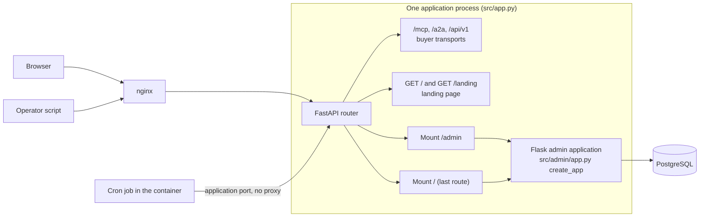
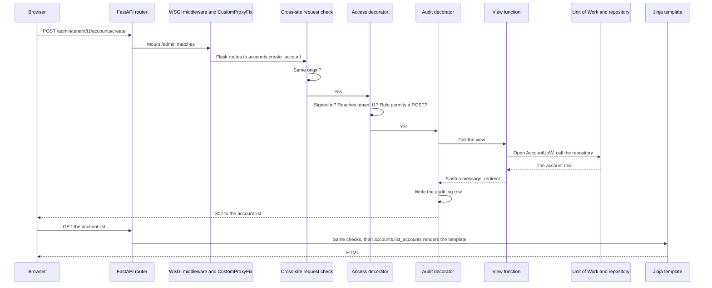

# Admin UI architecture

The Admin UI is a Flask application that publishers and operators use in a browser. It
configures tenants, products, advertisers, and ad server connections, and it is where a
person approves media buys and creatives. This page is the map of that application: where it
runs, how a request reaches a view, and where each kind of code lives.

The [Architecture guide](architecture.md) maps the whole system. This page goes one level
deeper into the box that the guide labels "Flask admin UI".

## Where the Admin UI runs

One process serves the buyer-facing transports and the Admin UI. `src/app.py` builds a
FastAPI application, creates the Flask application with `create_app`, wraps it in
`a2wsgi.WSGIMiddleware`, and mounts it twice.



The two mounts have different jobs:

- **`/admin`** is the address of the Admin UI. A browser opens `/admin/login`,
  `/admin/tenant/<tenant_id>`, and so on.
- **`/`** is a catch-all. Starlette sends a request to the first route that matches both
  its path and its method. The root mount matches every path and method, so the Flask
  application receives every request that no FastAPI route claims. That includes a request
  whose path a FastAPI route serves only for other methods, such as `POST /`.

A Flask path is also reachable at the root when no FastAPI route claims it. The cron job
calls the Inventory Sync API there, and the `/tenant/<tenant_id>/...` pages work there too.
The code builds the following sign-in callback URLs on the `/admin` mount:

- The OpenID Connect (OIDC) callback is always `/admin/auth/oidc/callback` on the tenant's
  host.
- In production, the Google sign-in callback defaults to `/admin/auth/google/callback`. The
  Google Ad Manager (GAM) authorization callback is `/admin/auth/gam/callback`.

`_install_admin_mounts` in `src/app.py` creates both mounts when the application's lifespan
starts. It removes any earlier copies, then appends the `/admin` mount and the root mount at
the end of the route list. That keeps the catch-all behind every route that `src/app.py`
registers.

`src/admin/server.py` is a second entry point that serves the Flask application alone. It
runs Werkzeug when `FLASK_DEBUG` is true or `ADMIN_SERVER_TYPE` is `werkzeug`, Uvicorn when
`ADMIN_SERVER_TYPE` is `uvicorn`, and Waitress otherwise. The unified process in
`src/app.py` is the one the container runs.

[Request lifecycle](request-lifecycle.md#one-process-four-entry-points) describes the entry
points of the process and what the proxy does.

### How the application knows its URL prefix

A page under `/admin` must build links that start with `/admin`. Flask builds links from
`SCRIPT_NAME`, which reaches the application in two ways:

- The `/admin` mount passes its path as the ASGI `root_path`, and `a2wsgi` copies it to
  `SCRIPT_NAME`.
- `CustomProxyFix` in `src/admin/app.py` reads the `X-Script-Name` header or, when that
  header is absent, `X-Forwarded-Prefix`. It sets `SCRIPT_NAME` to the header's value, and
  removes the prefix from the path when the path starts with it. On a redirect, it adds the
  prefix to a `Location` header that starts with `/` and lacks the prefix. The multi-tenant
  nginx configuration sets `X-Forwarded-Prefix` to `/admin`.

Code must never write `/admin` or a root-relative path into a link. In a template, build
links with `url_for`. In a page script, prefix the path with `request.script_root`. Some
templates, including `base.html`, prefix paths with the `script_name` template variable
instead. [Add an Admin UI page](admin-ui-add-a-page.md#write-the-template) shows both rules.

## What `create_app` builds

`create_app(config=None, settings=None)` in `src/admin/app.py` is the factory. It does the
following, in order:

1. It loads the settings, or takes the settings object that `src/app.py` already loaded.
1. It creates the Flask application with the repository's `templates/` and `static/`
   directories.
1. It sets the secret key and the session cookie options.
   [Session cookie configuration](../security.md#session-cookie-configuration) lists them.
1. It registers the Jinja filters `from_json` and `markdown`.
1. In production, it sets the preferred URL scheme to `https`.
1. It applies the `config` argument, if one is given.
1. It wraps the application in the proxy middleware. Production adds Werkzeug's `ProxyFix`
   and a middleware that maps the Fly.io forwarding headers.
1. It registers the cross-site request check of `src/admin/csrf.py` as a `before_request`
   hook.
1. It calls `init_oauth`, which registers the deployment's OAuth client when it finds a
   client ID, a client secret, and a discovery URL.
1. It creates an in-memory cache, `app.cache`, with a five-minute default lifetime.
1. It registers the `after_request` hook `log_auth_cookies`. The hook logs the names and
   attributes of the cookies that responses on `/auth`, `/login`, and `/admin` paths set.
1. It registers the context processor `inject_context`. Every template receives
   `script_name` and `support_email`. A template also receives `tenant` when the session
   holds a `tenant_id` whose tenant row exists.
1. It registers the blueprints.
1. It calls `register_adapter_routes`, which registers the configuration routes of each
   adapter that it can construct. It then calls `create_inventory_endpoints`, which returns
   without registering a route.

The cross-site request check is the application's one `before_request` hook.
[Cross-site request forgery](../security.md#cross-site-request-forgery) describes it. The
application has no application-level error handler.

## How a request reaches a view

The following diagram shows the path of a form `POST` to `accounts.create_account`, and of
the page that follows it.



The diagram follows `accounts.py`, the model for a tenant route. The following list
describes each part of the path and where other admin code differs:

- **The cross-site request check runs first.** It is the application's `before_request`
  hook, so it runs after routing and before any decorator. It refuses a state-changing
  request from another origin. See
  [Cross-site request forgery](../security.md#cross-site-request-forgery).
- **The access decorator runs next.** In `accounts.py` and `signing_keys.py`,
  `require_tenant_access` sits directly under the route decorator. It refuses a caller who
  is not signed in, who does not reach the tenant, or whose role does not permit the
  request. Many other views place `log_admin_action` above it, so the audit decorator runs
  first in those views. Some tenant routes use `require_auth()` instead, and some carry no
  access decorator. [Admin UI authentication and permissions](admin-ui-authentication.md)
  describes every check.
- **The audit decorator wraps the view.** Where a view carries `log_admin_action`, the
  decorator writes one row to `audit_logs` for each call when the URL names a tenant. It
  writes the row whatever the HTTP method, so a view that also serves a form audits each
  `GET`. Some state-changing routes do not carry the decorator. See
  [Audit trail](../security.md#audit-trail).
- **The view answers in one of a few shapes.** A page route flashes a message and redirects,
  or renders a template. A route that a script calls returns JSON.
  `activity_stream.activity_events` answers with a stream of server-sent events.

## Blueprints

Every route except Flask's built-in `static` route belongs to a blueprint. `create_app`
registers the blueprints from `src/admin/blueprints/`, plus the operator API and GAM
reporting blueprints from other modules. The following table groups them by the part of the
Admin UI they serve.

| Area | Blueprint modules | URL prefix |
|---|---|---|
| Sign-in and signup | `auth.py`, `oidc.py`, `public.py` | `/login`, `/auth/...`, `/signup` |
| Tenant list and platform pages | `core.py`, `settings.py` (`tenant_management_settings_bp`) | `/`, `/create_tenant`, `/settings` |
| Dashboard and tenant settings | `tenants.py`, `settings.py` (`settings_bp`), `users.py`, `policy.py` | `/tenant/<tenant_id>`, `/tenant/<tenant_id>/settings`, `/tenant/<tenant_id>/users` |
| Ad server connection | `adapters.py`, `gam.py` | `/tenant/<tenant_id>/gam`, `/api/tenant/<tenant_id>/adapter-config` |
| Products and inventory | `products.py`, `inventory.py`, `inventory_profiles.py` | `/tenant/<tenant_id>/products`, `/tenant/<tenant_id>/inventory`, `/tenant/<tenant_id>/inventory-profiles` |
| Publishers | `publisher_partners.py`, `authorized_properties.py` | `/tenant/<tenant_id>/publisher-partners`, `/tenant/<tenant_id>/authorized-properties` |
| Advertisers and buyer accounts | `principals.py`, `accounts.py` | `/tenant/<tenant_id>/principals`, `/tenant/<tenant_id>/accounts` |
| Media buys and workflows | `operations.py`, `workflows.py`, `activity_stream.py` | `/tenant/<tenant_id>/media-buy/...`, `/tenant/<tenant_id>/workflows` |
| Creatives | `creatives.py`, `creative_agents.py`, `format_search.py` | `/tenant/<tenant_id>/creatives`, `/tenant/<tenant_id>/creative-agents`, `/api/formats` |
| Signals and signing | `signals_agents.py`, `signing_keys.py` | `/tenant/<tenant_id>/signals-agents`, `/tenant/<tenant_id>/signing-keys` |
| JSON helpers for pages | `api.py` | `/api` |
| Ad Context Protocol (AdCP) JSON schemas for API clients | `schemas.py` | `/schemas` |
| Operator APIs | `src/admin/tenant_management_api.py`, `src/admin/sync_api.py` | `/api/v1/tenant-management`, `/api/sync` |
| GAM reporting | `src/adapters/gam_reporting_api.py` | `/api/tenant/<tenant_id>/gam/reporting` |

The [Admin UI route reference](admin-ui-routes.md) lists every route with its access check
and audit operation. A script generates that page from the URL map, so trust it over this
table when the two differ.

A blueprint gets its prefix in one of two places: the `Blueprint(...)` call in its module,
or the `register_blueprint(...)` call in `create_app`. The prefix in `create_app` wins when
both exist. `sync_api` is the one blueprint where they differ: the module declares
`/api/v1/sync`, and `create_app` registers `/api/sync`.

## Where the code lives

The following list maps each location to the code that it holds.

- `src/admin/app.py`: The factory `create_app` and `CustomProxyFix`.
- `src/admin/blueprints/`: The blueprint modules, one per area, with their routes and view
  functions. `settings.py` holds both `settings_bp` and `tenant_management_settings_bp`.
- `src/admin/utils/helpers.py`: The access decorators `require_auth` and
  `require_tenant_access`, and `is_super_admin`.
- `src/admin/utils/audit_decorator.py`: `log_admin_action` and
  `record_admin_action_failure`.
- `src/admin/utils/operator_errors.py`: `safe_error_message`, which hides database error
  text from a response.
- `src/admin/utils/url_policy.py`: `redirect_if_url_blocked` and `json_error_if_url_blocked`,
  which refuse a URL that the egress policy blocks. Agent URLs, webhooks, and OIDC addresses
  go through them.
- `src/admin/services/`: Read models for the dashboard and other tenant pages:
  `DashboardService`, `MediaBuyReadinessService`, and the business activity feed.
- `src/admin/auth_helpers.py`: `require_api_key_auth`, the API key check of the operator
  APIs.
- `src/admin/domain_access.py`: Functions that map an email address to the tenants it
  reaches, add a user to a tenant, and edit authorized domains and emails.
- `src/services/`: Services that the Admin UI shares with the rest of the system, for
  example `setup_checklist_service.py` and `publisher_ingest.py`.
- `src/core/database/repositories/`: The repositories and the Unit of Work classes.
- `templates/`: The Jinja templates, at the repository root.
- `static/`: The scripts, style sheets, and images, at the repository root.

### Templates and static files

Pages extend `templates/base.html`, which defines the blocks `title`, `content`, and
`scripts`. The exceptions are `oidc_test_success.html` and the tenant landing page, which
`core.index` can return from `src/landing/`. The base template draws the header, the
navigation, and the flash messages. It loads Bootstrap and Font Awesome from a content
delivery network.

Reusable fragments are in `templates/components/` and `templates/partials/`. The
Broadstreet, Google Ad Manager, and mock adapters each have a connection form and a product
form in `templates/adapters/<adapter>/`. The Kevel and Triton adapters have neither.

Most page scripts are inline in the template that uses them, and some are several hundred
lines long. A few scripts are separate files in `static/js/`, and `base.html` loads
`static/validation.js`.

## Data access

In the target style, the Admin UI reaches the database through the same repositories as the
rest of the system. A view opens a Unit of Work for the tenant and calls a repository method:

```python
with AccountUoW(tenant_id) as uow:
    account = uow.accounts.get_by_id(account_id)
```

The Unit of Work classes are in `src/core/database/repositories/uow.py`.
[Patterns reference](patterns-reference.md) describes the repository and Unit of Work
patterns in full.

The admin code is in the middle of a migration to this pattern, so you find two styles:

- **The target style.** `accounts.py`, `signing_keys.py`, and `publisher_partners.py` reach
  the database only through a Unit of Work and its repositories. `creatives.py` calls no
  `get_db_session()`, but it reads the deprecated `uow.session` and builds repositories on it.
- **The earlier style.** Many blueprints open a session with `get_db_session()` and run
  queries in the view. That code is tracked debt.

The following mechanisms stop the earlier style from growing:

- `.admin-raw-session-baseline` records how many times admin code calls `get_db_session()`
  and `session.add()`. `.pre-commit-hooks/check_admin_raw_session_count.py` fails
  `make quality` when either number rises.
- The structural guard `test_architecture_no_raw_select.py` refuses a raw `select()` on an
  object-relational mapping (ORM) model anywhere under `src/`, outside the repositories and
  its allowlist. The guard `test_architecture_repository_pattern.py` checks `creatives.py`
  for `get_db_session()` calls, but no other admin module. See
  [Structural guards](structural-guards.md).

Write every admin view that you add in the target style.

## Work outside the request

Most admin work happens inside a request. The following pieces run elsewhere:

- **Inventory sync.** A sync that an operator starts runs in a background thread, which
  `start_inventory_sync_background` in `src/services/background_sync_service.py` creates.
  The page polls a status route until the `SyncJob` row completes or fails.
- **AI creative review of synced creatives.** For a tenant whose approval mode is
  `ai-powered`, `src/core/tools/creatives/_processing.py` submits each synced creative's
  review to `_ai_review_executor`, a thread pool that `creatives.py` defines. The admin
  route `creatives.ai_review_creative` does not use that pool: it runs its review inside the
  request and waits up to 60 seconds.
- **Scheduled jobs.** The container runs cron jobs from the `crontab` file at the repository
  root. `scripts/ops/sync_all_tenants.py` triggers a full inventory sync for each GAM tenant
  every six hours, and again daily at 07:00 UTC. `scripts/ops/refresh_publishers.py`
  refreshes every publisher's `adagents.json` every six hours. The sync job calls the
  Inventory Sync API on the application port directly, without nginx. Setting `SKIP_CRON`
  to `true` turns the jobs off.

`create_app` starts no thread. The delivery and media buy status schedulers belong to the
MCP server's lifespan in `src/core/main.py`, not to the Admin UI.

The dashboard renders its activity feed on the server. `activity_stream.py` also serves the
feed as JSON and as server-sent events. The dashboard does not call those routes.

## Tests

The Admin UI has the following test layers:

- **`tests/admin/`** holds most of the route tests. They run the real application against
  PostgreSQL. `tests/admin/README.md` explains how a test signs in and how to run the suite.
  More admin tests are in `tests/integration/`, `tests/unit/admin/`, and `src/admin/tests/`.
- **`tests/bdd/`** holds the admin BDD scenarios. See
  [Admin UI BDD pattern](admin-bdd-pattern.md).
- **Guards over the whole application.** `test_architecture_admin_templates_exist.py`
  checks that every template named by a string literal in a `render_template` call under
  `src/admin/` exists. `test_template_url_validation.py` checks that every `url_for` in a
  template resolves. The route-conflict hook fails when two URL rules with the same rule
  string share an HTTP method other than `HEAD` or `OPTIONS`.

## Direction of travel

The Admin UI does not follow every rule that the tool layer follows. When you change it, move
code toward the following targets and never away from them:

- A view validates input, calls a repository or a service through a Unit of Work, and
  answers. It holds no query.
- Every tenant route carries `require_tenant_access`.
- Every state-changing route carries `log_admin_action`.

`accounts.py` is the blueprint to copy. [Add an Admin UI page](admin-ui-add-a-page.md) walks
through it.

## Related documentation

- [Add an Admin UI page](admin-ui-add-a-page.md) is the how-to for a route, a template, and
  its tests.
- [Admin UI authentication and permissions](admin-ui-authentication.md) covers sign-in, the
  session, and the access checks.
- [Admin UI route reference](admin-ui-routes.md) lists every route.
- [Tenant Management API and Inventory Sync API](../operations/admin-apis.md) documents the
  two operator APIs.
- [User guide](../user-guide/README.md) describes the Admin UI from the operator's side.
