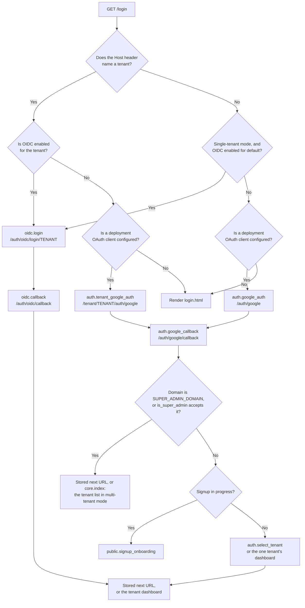

# Admin UI authentication and permissions

This page describes how the Flask admin application signs a person in, what it keeps in the
session, and how each route decides who can call it. Read it before you add or change an
admin route.

[Security and authentication](../security.md#admin-authentication-architecture) covers the
super admin check, the session cache, the steps of the tenant access check, the tenant roles,
the cross-site request check, and the cookie settings. This page does not repeat those
sections.

## The access model

The admin application has three kinds of caller. The following table lists them.

| Caller | Identified by | Reaches |
|---|---|---|
| Super admin | A signed-in email address that `is_super_admin` accepts | Every tenant through the access checks; in multi-tenant mode, also the tenant list when the session role is `super_admin` |
| Tenant user | A signed-in email address with access to one tenant | That tenant, within the user's role, on routes guarded by `require_tenant_access` |
| API client | A deployment-wide API key in a request header | The Tenant Management API or the Inventory Sync API |

A tenant user holds one role, stored in the `users.role` column of the user's row.
`require_tenant_access` reads it on every request:

- **`viewer`** opens pages and sends no `POST`, `PUT`, `PATCH`, or `DELETE` request.
- **`manager`** sends any request except to an admin-only route.
- **`admin`** also reaches the admin-only routes: users and roles, authorized domains and
  emails, setup mode, the SSO configuration, and tenant deactivation.

[Tenant users](../security.md#tenant-users) describes how a user gets each role. The session
role is a separate value. Production code writes `session["role"]` as `super_admin` at
sign-in and as `admin` after a self-service signup. Some views compare the session role to
`viewer`, `tenant_admin`, or `tenant_user`, values that no production code writes. The
equality comparisons never match, and `policy.update` refuses every caller whose session
role is not `super_admin`.

Issue [#2256](https://github.com/prebid/salesagent/issues/2256) tracks the wider design of
admin authorization.

## Sign-in flows

`src/admin/blueprints/auth.py` and `src/admin/blueprints/oidc.py` hold the sign-in routes.
A tenant signs its users in through one of two providers:

- **Per-tenant OpenID Connect (OIDC)**, which a tenant configures on its **Users & Access**
  page. [SSO setup](../user-guide/sso-setup.md) is the operator guide.
- **The deployment's OAuth client**, which the environment configures, or failing that a
  `client_secret.json` file at the repository root. See
  [Generic OIDC provider support](../security.md#generic-oidc-provider-support).

The following diagram shows how the `login` view picks a provider and where each path ends.



In single-tenant mode, a request whose host names no tenant goes to `oidc.login` for the
tenant `default` when that tenant's OIDC is enabled. When `logout` redirects to the login
page, it adds `logged_out=1`, and with it `login` and `tenant_login` render `login.html`
instead of redirecting to a provider.

### The deployment OAuth callback

`google_callback` handles every sign-in that uses the deployment's OAuth client. It does the
following:

1. It reads the user's claims with `extract_user_info`. The function lowercases the email
   address.
1. It writes `user`, `user_name`, and `user_picture` to the session.
1. When the address's domain equals `SUPER_ADMIN_DOMAIN`, or `is_super_admin` accepts the
   address, it writes `is_super_admin` and `role`. It then redirects to the stored `next`
   URL, or to `core.index`, which shows the tenant list in multi-tenant mode.
1. For a self-service signup, it redirects to the onboarding page.
1. For everyone else, it calls `get_user_tenant_access` to list the tenants the address can
   reach, and stores the list as `available_tenants`.
1. In single-tenant mode with exactly one tenant, it makes sure the tenant has a user row
   for the address, writes `tenant_id` and `is_tenant_admin`, and redirects to the stored
   `next` URL or the dashboard.
1. In every other case, it redirects to `select_tenant`. After the person picks a tenant
   from the stored list, that view does the same for the chosen tenant.

`get_user_tenant_access` in `src/admin/domain_access.py` considers active tenants only. It
grants a tenant for any of the following reasons:

- The tenant has an active `users` row for the address.
- The tenant is the first active tenant that lists the address's domain in
  `authorized_domains`, unless that domain is `SUPER_ADMIN_DOMAIN`.
- The tenant lists the address in `authorized_emails`.

### The per-tenant OIDC callback

`oidc.callback` handles a sign-in through a tenant's own provider. It reads the tenant from
the session, where `oidc.login` stored it. It then looks for a `users` row with the address
and the tenant:

- An active row signs the person in.
- An inactive row refuses the person.
- With no row, the callback creates one when the tenant lists the address's domain in
  `authorized_domains`. Otherwise it refuses the person.

This path does not consult `authorized_emails`. To admit one address through OIDC, add the
person on the **Users & Access** page, which creates the row.

The callback writes `user`, `user_name`, `tenant_id`, `authenticated`, and `auth_method` to
the session.

### Setup mode

`Tenant.auth_setup_mode` starts as true, except on the demo tenant that `init_db` creates.
It has one effect on sign-in: `oidc.login` accepts
an OIDC configuration that is saved and not yet enabled. That lets an administrator test the
provider before the tenant depends on it.

The **Users & Access** page turns setup mode off through `disable_setup_mode`. The view
requires a session whose `auth_method` is `oidc` and a tenant whose OIDC is enabled, so a
person must first sign in through the tenant's provider.

`require_tenant_access` also accepts a test session, through `_setup_session_reaches`. That
branch reads the session keys `test_user`, `test_tenant_id`, and `test_user_role`, and it
always answers no in production. No route creates such a session; only test code signs one.
Use `tests/helpers/admin_session.py` in a test; older copies live in some test modules.

### Sign-out

`logout` clears the session. It then redirects to the tenant's OIDC logout URL when one is
configured, and to the login page otherwise.

## Session keys

The session is a signed Flask cookie. The following table lists the keys that the access
checks and the templates depend on.

| Key | Written by | Read by |
|---|---|---|
| `user` | Both callbacks | Every access check. Its presence means "signed in". |
| `user_name` | Both callbacks | `google_callback`, `select_tenant`, and the signup views, which use it to name a user they create |
| `is_super_admin` | `google_callback`, and `is_super_admin` as its cache | `is_super_admin` and `public.landing` |
| `admin_email` | `is_super_admin` as its cache | `is_super_admin` |
| `role` | `google_callback` for a super admin, and the signup flow | The header in `base.html`, `index.html`, the reporting API's tenant check, and the inline role checks in some views |
| `tenant_id` | Both callbacks, `select_tenant`, and the signup flow | The template context processor, `logout`, the landing and index views, the reporting API's tenant check, and the inline tenant checks in some views |
| `available_tenants` | `google_callback` | `select_tenant` |
| `login_next_url` | `login` and `tenant_login` | Both callbacks and `select_tenant` |
| `authenticated`, `auth_method` | `oidc.callback` only | `base.html` and `disable_setup_mode` |

`google_callback` never writes `authenticated` or `auth_method`.

The sign-in flows also write the following keys:

- `oidc_test_flow`, `oidc_test_tenant_id`, and the three `gam_oauth_` keys of the Google Ad
  Manager connection flow, which their callbacks remove.
- `oidc_login_tenant_id`, which `oidc.callback` removes once the provider returns an email
  address.
- `signup_flow` and `signup_step`, which last until the tenant is provisioned.
- `oauth_tenant_context` and `oauth_originating_host`, which `tenant_google_auth` writes and
  which stay until the session is cleared. Nothing reads `oauth_originating_host`.

Do not add a session key without a reader. A key that a callback writes and no check reads
looks like a permission and is not one.

## Access checks

A route states its access check as a decorator. The following table lists the checks.

| Decorator | Defined in | Passes when | Refuses with |
|---|---|---|---|
| `require_tenant_access()` | `src/admin/utils/helpers.py` | The caller is signed in, reaches the tenant in the URL, and holds a role that permits the method | A redirect to the tenant login page, `401` JSON for a caller that reads JSON, or `403` |
| `require_tenant_access(role=UserRole.ADMIN)` | `src/admin/utils/helpers.py` | The same, and the caller is a super admin or a tenant admin | The same |
| `require_tenant_access(api_mode=True)` | `src/admin/utils/helpers.py` | The same as `require_tenant_access()` | `401` or `403` with a JSON body |
| `require_auth()` | `src/admin/utils/helpers.py` | The caller is signed in | A redirect to the login page |
| `require_auth(admin_only=True)` | `src/admin/utils/helpers.py` | The caller is a super admin | A redirect to the login page, or `403` |
| `require_sync_api_key` | `src/admin/sync_api.py` | The `X-API-Key` header holds the sync key | `401` or `503` with a JSON body |
| `require_tenant_management_api_key` | `src/admin/tenant_management_api.py` | The `X-Tenant-Management-API-Key` header holds the key | `401` or `503` with a JSON body |

The [Admin UI route reference](admin-ui-routes.md) lists the check on every route.

### `require_tenant_access`

Use this decorator on every route whose URL has a `tenant_id`. The decorated view receives
`tenant_id` as its first argument. The check passes for a super admin, and for a tenant user
whose role permits the request.
[Tenant access guard](../security.md#tenant-access-guard) lists its steps.

Pass the least role the route needs as `role`. Without it, a read needs `viewer` and a write
needs `manager`. Pass `role=UserRole.ADMIN` on a route that manages users, sign-in, or the
tenant itself. The check then refuses a viewer and a manager, whatever the method.

The check answers with a JSON body instead of a redirect or an HTML page in two cases: you
pass `api_mode=True`, or the caller reads JSON. A caller reads JSON when it sends a JSON
body, calls through `fetch` or `XMLHttpRequest`, or prefers `application/json` in `Accept`.
The JSON answers are the following:

- `401` with `{"error": "Authentication required"}` for a caller who is not signed in
- `403` with `{"error": "Access denied"}` for a caller who does not reach the tenant
- `403` with `{"error": "Your role does not allow this"}` for a caller whose role does not
  permit the request

### `require_auth`

`require_auth()` checks only that the caller is signed in. It does not compare the caller to
a tenant. Use it on a route with no `tenant_id`, and pass `admin_only=True` on a route for
super admins.

Some routes carry `require_auth()` although their URL has a `tenant_id`. Some of them
compare `session["tenant_id"]` to the URL unless the session role is `super_admin`.
`policy.update` refuses every caller whose session role is not `super_admin`. The others
accept any signed-in caller for any tenant. None of them reads the stored role. Do not copy
any of these forms. Use `require_tenant_access` instead. Issues
[#2203](https://github.com/prebid/salesagent/issues/2203) and
[#2233](https://github.com/prebid/salesagent/issues/2233) track these routes.

`src/adapters/gam_reporting_api.py` defines its own `require_auth`, without parentheses, and
a `get_tenant_access` helper. Those belong to that module only.

### API keys

The two API key decorators come from `require_api_key_auth` in `src/admin/auth_helpers.py`.
[Tenant Management API and Inventory Sync API](../operations/admin-apis.md) describes where
each key comes from and what the check returns.

### Cross-site requests

Before any view runs, `src/admin/csrf.py` refuses with `403` a `POST`, `PUT`, `PATCH`, or
`DELETE` request that comes from another origin.
[Cross-site request forgery](../security.md#cross-site-request-forgery) describes the check.
A form or a `fetch` call from an Admin UI page passes without a token, so the `csrf-token`
meta tag in `base.html` stays empty. The two API key decorators wrap their views in
`csrf_exempt`.

### Routes with no access decorator

The route reference shows `none` for a route with no access decorator. Such a route belongs
to one of the following groups:

- **The sign-in surface.** The login pages, the provider redirects, the callbacks, and
  `logout` must be reachable before a session exists.
- **Views that check the session in their body.** `select_tenant`, the index page,
  `gam_callback`, `public.signup_onboarding`, and `public.provision_tenant` do this.
- **Public pages.** `public.signup_start`, `public.signup_complete`, the static file routes,
  the health and metrics routes, and the JSON schema routes take no caller identity.
- **Gaps.** The routes in `publisher_partners.py`, `oidc.test_initiate`, and
  `core.debug_headers` have no check. Issue
  [#2496](https://github.com/prebid/salesagent/issues/2496) tracks the publisher routes.

A route that you add must carry an access decorator unless it belongs to the first three
groups.

## The audit log and access checks

`log_admin_action` records who did what. Place it under the access check, so that the check
runs first:

```python
@accounts_bp.route("/create", methods=["GET", "POST"])
@require_tenant_access()
@log_admin_action("create_account")
def create_account(tenant_id: str):
    ...
```

[Audit trail](../security.md#audit-trail) describes what the decorator writes. Many views
have the two decorators in the other order. Follow the order in this example, which is the
one the docstring of `src/admin/utils/audit_decorator.py` documents.

## What the admin application does not have

- **No configured session lifetime.** The session cookie has no expiry date. Flask discards
  a cookie signed more than 31 days earlier, and it signs the cookie again whenever the
  session changes. Without `FLASK_SECRET_KEY`, each process generates its own secret, so a
  restart ends every session.
- **No per-tenant API keys.** Each of the two API keys reaches every tenant.

## Test an access check

`tests/helpers/admin_session.py` is the shared helper that tests use to become a
signed-in admin. Use
`admin_auth_session(client, tenant_id)` with the `admin_client` fixture from
`tests/admin/conftest.py`.

The helper signs a super admin session, and a super admin passes every check. A test that
signs in this way proves that a route works. It cannot prove that the route refuses a
caller. To test a refusal, send the request with no session, or sign in an ordinary tenant
user with `tenant_user_session(client, email)`. With that session, the check reads the
user's `User` row and applies its role. A viewer gets `403` on a write or an admin-only
route, and a user with no active row in the tenant gets `403` on every route.

The following tests pin the behavior that this page describes:

- `tests/integration/test_audit_decorator_auth_order.py` covers the order of the audit and
  access decorators.
- `tests/integration/test_admin_role_enforcement.py` covers the roles on the admin routes.
- `tests/unit/test_admin_role_permits.py` covers which request each role permits.
- `tests/unit/test_admin_csrf_protection.py` covers the cross-site request check and the
  production cookie flags.
- `tests/admin/test_oidc_blueprint.py` covers the OIDC configuration routes: reading and
  saving the configuration, and enabling and disabling it.
- `tests/unit/test_auth_setup_mode.py` covers setup mode.
- `tests/unit/test_auth_helpers.py` covers the API key check.

## Related documentation

- [Security and authentication](../security.md) covers the super admin check, the cookie
  settings, and the audit trail.
- [SSO setup](../user-guide/sso-setup.md) is the operator guide for per-tenant OIDC.
- [Admin UI architecture](admin-ui-architecture.md) shows where the admin application sits
  in the process.
- [Add an Admin UI page](admin-ui-add-a-page.md) applies these checks to a route you write.
