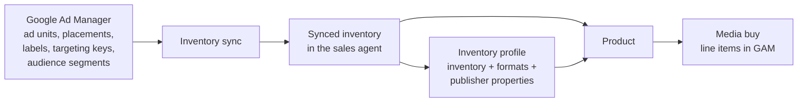

# Inventory and inventory profiles

For a tenant that uses Google Ad Manager (GAM), the sales agent keeps a copy of the ad
server's inventory. The copy holds ad units, placements, labels, targeting keys, and
audience segments.
Products and inventory profiles point at that copy. This page explains how to sync the
copy, how to browse it, and how to group inventory into reusable profiles.

A tenant that uses another adapter has no inventory to sync. For such a tenant, the
**Inventory & Profiles** page shows only the **Publishers & Properties** tab, which
[Publishers and authorized properties](publishers.md) describes.

## How the pieces fit

The following diagram shows how inventory reaches a product.

A product names its inventory in one of two ways: it selects ad units and placements
itself, or it links to an inventory profile that selects them.

## Sync inventory

### Before you start

The tenant must be connected to GAM with a network code. Without one, a sync is refused
with the message **Please connect your GAM account before trying to sync inventory. Go to
Ad Server settings to configure GAM.** See [Tenant settings](settings.md#ad-server).

### Run a sync from the settings page

To sync inventory, do the following:

1. Open **Settings** and select the **Inventory** section.
1. Click one of the sync buttons:
   - **Incremental Sync** reads only the items that changed since the last completed sync.
     The button is unavailable until one sync has completed.
   - **Full Reset** deletes the stored inventory of the tenant and reads everything again.
1. Wait while the page shows **Sync in progress**. The page checks the status every two
   seconds and reports when the sync ends.

The sync runs in the background, so you can leave the page. Only one sync runs per tenant at
a time. A second request is refused while the first one runs.

Use **Incremental Sync** for routine updates. Use **Full Reset** when the stored inventory
is wrong, for example after a large reorganization in GAM. A full reset takes longer, and
the stored inventory is incomplete while it runs.

When an incremental sync finds no earlier completed sync, it runs as a full sync.

### What a sync reads

A sync reads the following from GAM, in this order:

1. Ad units
1. Placements
1. Labels
1. Custom targeting keys
1. Audience segments

A sync does not read the values of custom targeting keys. The targeting browser reads the
values of a key from GAM when you open the key.

After a full sync, an item that GAM no longer returns is marked stale.

### Read the sync status

The **Inventory Sync Status** card shows the totals of the stored inventory: **Total
Items**, **Ad Units**, **Placements**, and **Targeting (Keys+Values)**. Under the totals,
the card shows the time of the last sync, or **No sync performed yet**.

### Reset a sync that does not finish

If the status stays at **Sync in progress** long after a sync should have ended, click
**Reset Stuck Sync**. The sales agent marks the running job as failed, and you can start
another sync.

The sales agent also fails a job by itself when the job has run for more than one hour with
no progress. It does this check when the next sync starts.

### Scheduled sync

A deployment with cron turned on syncs every active GAM tenant on a schedule, every six
hours and once more at 07:00 UTC. The schedule has the following limits:

- It needs the `SYNC_API_KEY` environment variable.
- It covers only a tenant that connects to GAM with OAuth. A tenant that uses a service
  account is skipped, so sync it from the Admin UI.
- A scheduled run does nothing when the tenant already completed a sync on the same UTC day.

[Tenant Management API and Inventory Sync API](../operations/admin-apis.md#the-scheduled-inventory-sync)
describes the schedule for the people who operate the deployment.

## Browse inventory

In the **Inventory** section of the settings page, click **Browse Inventory**. The
**Inventory & Profiles** page opens. For a GAM tenant, it has three tabs:

- **Publishers & Properties**
- **Inventory Profiles**
- **Browse Inventory**

The **Browse Inventory** tab has the following parts:

- **Inventory Status** shows the time of the last sync.
- **Quick Stats** counts the stored ad units, placements, labels, targeting keys, and
  audience segments.
- **Search Inventory** filters by name or path, by type, and by status.
- **Ad Unit Hierarchy** shows the ad units as a tree. The tree loads the children of an ad
  unit when you expand it, and it shows active ad units only.
- **Inventory Details & Selection** shows the items you selected. Click **Create Profile**
  to start an inventory profile from the selection.

The tab also has two sync buttons, and each behaves differently from its label:

- **Sync All** runs a full reset. It deletes the stored inventory and reads everything
  again, and it does not ask for confirmation.
- **Selective** opens a dialog where you pick inventory types and limits. The sync that
  follows ignores those choices. It runs an incremental sync of every type.

For a predictable result, use the two buttons in the **Inventory** section of the settings
page instead.

## Browse targeting

In the **Inventory** section of the settings page, click **Browse Targeting**. The
**Targeting Criteria Browser** has three tabs: **Custom Targeting**, **Audience Segments**,
and **Labels**.

On the **Custom Targeting** tab, click a key to load its values. The values come directly
from GAM at that moment, up to 1,000 per key.

**Sync Targeting Data** starts an incremental inventory sync of every type, not only of the
targeting data.

## Inventory profiles

An inventory profile is a named bundle that several products can share. A product that
links to a profile takes the following from it:

- **Inventory.** The ad units and placements that the product's line items target, and
  whether the targeting includes child ad units.
- **Creative formats.** The format declarations that the product accepts.
- **Publisher properties.** The properties that the product sells.

When you change a profile, every linked product changes with it. The change applies to
media buys created afterward. Line items that already exist in GAM stay as they are.

Inventory profiles are available for a GAM tenant only.

### List the profiles

On the **Inventory & Profiles** page, select the **Inventory Profiles** tab. The tab shows
three counters, **Total Profiles**, **In Use**, and **Unused**, and one card per profile.
Each card shows the name, the number of products that use the profile, and a summary of its
inventory, formats, and properties.

### Create a profile

To create a profile, do the following:

1. On the **Inventory Profiles** tab, click **Create Your First Profile**, or select
   inventory on the **Browse Inventory** tab and click **Create Profile**.
1. Under **Profile Information**, enter a name and, optionally, a description.
1. Under **Inventory (Ad Units & Placements)**, select the ad units and placements.
1. Under **Creative Formats**, select at least one format.
1. Under **Authorized Properties**, select **All Authorized Properties** or
   **Select Specific Properties**.
1. Click **Save Profile**.

The sales agent refuses a profile and shows the reason in the following cases:

- The name is empty: **Profile name is required**.
- No format is selected: **At least one canonical format declaration (format_options) is
  required**.
- The property selection names a property or a tag that no publisher authorizes. The
  messages are the same as on the product form.
- The publishers changed while the form was open: **The publishers of this profile changed
  since this page was opened. Reload the page and save your changes again.**

The profile editor offers only properties that a publisher authorizes at that moment. Add
the publishers first. See [Publishers and authorized properties](publishers.md).

### Edit a profile

On the card of the profile, click **Edit**, change the fields, and click **Save Profile**.

When products use the profile, the confirmation says how many, and it reminds you that the
change affects the media buys created afterward.

The sales agent refuses an edit that leaves a linked product with no format that all of the
product's sources accept. Change the product first, or keep a shared format in the profile.

### Delete a profile

On the card of the profile, click **Delete** and confirm. You cannot undo the deletion.

A profile that a product uses cannot be deleted. Its card shows **In Use** instead of
**Delete**. Unlink the profile from every product first.

### Link a product to a profile

On the product form of a GAM tenant, select the profile in the inventory profile field. The
product then takes its inventory, formats, and properties from the profile. See
[Products](products.md).

## Limitations

- The profile fields for a targeting template have no effect. The sales agent stores the
  value and does not use it when it creates line items.
- The standalone pages at `/tenant/<tenant_id>/inventory-profiles/add` and
  `.../<profile_id>/edit` have **Browse Ad Units** and **Browse Placements** buttons that
  do not open a picker. Use the editor on the **Inventory Profiles** tab.
- On the **Browse Inventory** tab, the status filter **All Status** shows active items
  only.

## Related documentation

- [Publishers and authorized properties](publishers.md) covers the first tab of the
  **Inventory & Profiles** page.
- [Products](products.md) covers the product form.
- [GAM product configuration](../adapters/gam/product-configuration.md) explains how a
  product's inventory becomes GAM line items.
- [Tenant settings](settings.md) covers the ad server connection.
