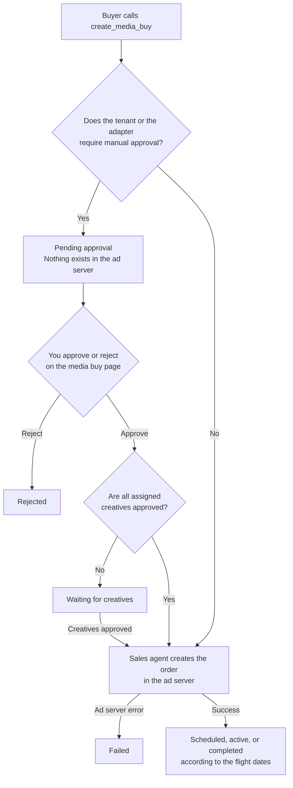

# Media buys, approvals, and workflows

A buyer's agent creates a media buy with the `create_media_buy` tool. This page explains
what you see in the Admin UI afterward. It covers the dashboard, the list of media buys, and
the detail page where you approve or reject a buy. It also covers the pages for workflows,
webhooks, and reports.

You do not create or edit a media buy in the Admin UI. The Admin UI reads media buys and
decides approvals.

## The life of a media buy

The following diagram shows what happens to a media buy after a buyer creates it.

### When a media buy needs approval

A media buy waits for your approval when either of the following settings is on:

- The tenant setting **Require manual approval for order activation**, under **Settings** >
  **Policies & Workflows** > **Approval Workflow**
- The **Require Manual Approval** option of the ad server adapter

A buy that waits has the status `pending_approval`. The sales agent creates nothing in the
ad server until you approve the buy.

When a Slack webhook is configured, the sales agent posts a **Media Buy Requires Approval**
notice with a link to the workflows page. See [Tenant settings](settings.md#integrations).

## The dashboard

The tenant dashboard is the first page after you sign in. It has the following parts.

- **Total Revenue (30d)**: The sum of the budgets of all active and completed media buys.
  The sum has no date limit. The line under it compares the last seven days with the seven
  days before.
- **Live Media Buys**: The number of media buys that are delivering, and the number
  scheduled to start.
- **Needs Attention**: The number of media buys that need creatives or approval or that
  failed, plus the creatives that wait for review. The links open the media buys list with a
  filter.
- **Active Advertisers**: The number of advertisers of the tenant.
- **Recent Activity**: The ten newest entries of the audit log from the last seven days.
  Reload the page to update the list.
- **Revenue by Advertiser**: A chart for the last 7, 30, or 90 days.
- **Recent Media Buys**: The newest media buys. Click a row to open the media buy. The
  **Spend** column is an estimate.
- **Operations**: Links to **Uploaded Creatives**, **Reports**, **Workflows**, **Webhooks**,
  and **Settings**.

## The media buys list

To open the list of all media buys, click a link in the **Needs Attention** card of the
dashboard. The list is at `/tenant/<tenant_id>/media-buys`.

The filter buttons select media buys by readiness. The following list explains each
readiness state.

- `needs_approval`: The media buy waits for your approval.
- `needs_creatives`: A package has no creative, or a creative is rejected or waits for
  review.
- `scheduled`: The media buy is ready and its start date is in the future.
- `live`: The media buy is delivering.
- `paused`: The media buy is paused.
- `completed`: The flight ended.
- `failed`: The ad server refused the order, or the order was canceled or deleted in GAM.
- `draft`: The media buy has no packages.

The **Ready** filter never matches a media buy. Use the other filters.

Click **View** to open a media buy.

## The media buy page

The page has the following sections:

- **Media Buy Information** shows the status, the budget, and the flight dates.
- **Delivery Metrics** appears for an active, approved, or completed media buy. It shows
  the ad server's data for at most the last seven days.
- **Advertiser Information** shows the advertiser that owns the buy.
- **Packages** lists the packages with their products.
- **Creative Assignments** lists the creatives of each package.
- **Workflow History** lists the workflow steps of the buy.

### Approve a media buy

A media buy that waits for approval shows the banner **Manual Approval Required**.

To approve the buy, do the following:

1. In the banner, click **Approve**.
1. Confirm. The page shows **Processing Approval** while the sales agent works. The ad
   server calls can take up to a minute.

What happens next depends on the creatives:

- **A creative of the buy is not approved.** The buy moves to the status
  `pending_creatives`, and the sales agent makes no ad server call. The message says that
  the buy waits for creative approval. The sales agent creates the order when the creatives
  are approved. See [Creatives](creatives.md).
- **Every assigned creative is approved.** The sales agent creates the order and the line
  items in the ad server and uploads the creatives. The buy then becomes `scheduled`,
  `active`, or `completed`, according to its flight dates. The message is **Media buy
  approved and order created successfully**.

When the ad server refuses the order, the buy moves to the status `failed`, and the message
is **Media buy approved but adapter creation failed**, followed by the reason. The approval
itself is already recorded, so the page offers no second **Approve** button, and the Admin
UI has no action that sends the order again.

After a successful approval, the sales agent notifies the buyer through the webhook that
the buyer registered for the request.

### Reject a media buy

To reject the buy, do the following:

1. In the banner, click **Reject**.
1. Enter the reason. The reason is required.
1. Confirm.

The buy moves to the status `rejected`, and the sales agent notifies the buyer through the
buyer's webhook. The page has no action that reverses a rejection.

### Send a delivery report

For a media buy whose request named a reporting webhook, the page has a **Test Webhook**
button. It sends the delivery report to the buyer's webhook at once.

## What the buyer sees

The Admin UI shows the stored status of a media buy. A buyer that reads the media buy
through the protocol sees a smaller set of statuses. For example, the buyer sees a buy that
waits for your approval as `pending_start`, and a `scheduled` buy as `active`.

A scheduler moves a media buy to `active` when its flight starts and to `completed` when
its flight ends.

## The workflows page

Open **Workflows** from the **Operations** panel of the dashboard. The page has four
counters and three tabs.

- **Media Buys** lists the media buys with a status filter.
- **Tasks** lists the workflow steps of the tenant. The tab has no actions.
- **Audit Logs** lists the last 100 entries of the audit log. You can filter the entries by
  text, date range, operation type, and status, and you can export them with **Export
  CSV**.

Approve and reject media buys on the media buy page, not on this page. The workflows page
has the following limits:

- The **Review & Approve** link in the **Media Buys** tab does not open an approval form.
  Open the media buy from the dashboard or the media buys list instead.
- The **Pending Tasks** counter does not count the media buys that wait for approval.
- The **Completed Today** counter is always zero.

## The webhooks page

Open **Webhooks** from the **Operations** panel. The page is a log view for delivery
webhooks, with filters for the media buy, the advertiser, and the number of rows.

The log reads audit entries that the sales agent does not write, so it stays empty. To see
whether a delivery webhook was sent, read the application log.

**Manage Webhooks** opens the advertisers page, where you register a webhook for an
advertiser.

## The reports page

Open **Reports** from the **Operations** panel. The page is available for a tenant that
uses Google Ad Manager. For another adapter, the page says that GAM reporting is not
available.

The report reads delivery data from GAM. You can choose the following:

- **Date Range**: today by hour, the current month by day, or the lifetime by day
- **Timezone**
- **Aggregate By**: advertiser, country, ad unit, order, or line item

The four tabs show the data as a table, a time series, a country view, and an ad unit
analysis. **Export Data** downloads the aggregated rows as a CSV file.

## Related documentation

- [Creatives](creatives.md) covers creative review, which a media buy can wait for.
- [Tenant settings](settings.md) covers the approval setting and the Slack integration.
- [Advertisers](advertisers.md) covers buyer webhooks.
- [GAM product configuration](../adapters/gam/product-configuration.md) explains how a
  media buy becomes GAM line items.
