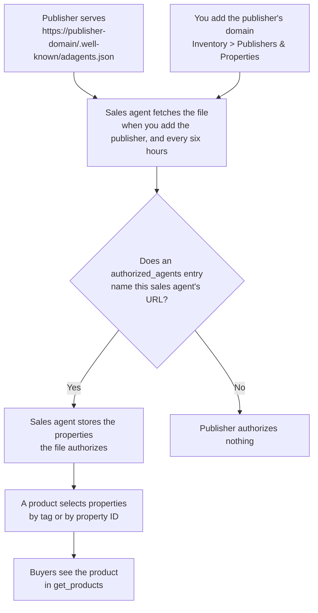

# Publishers and authorized properties

A sales agent sells inventory on behalf of publishers. A publisher states which sales agents
can sell its properties in a file named `adagents.json`, which it serves from its own
domain. The sales agent reads that file and offers buyers only the properties the file
authorizes.

You do not type properties into the Admin UI. You add a publisher's domain, and the sales
agent reads the properties from the publisher's file.

## How authorization works

The following diagram shows the path from a publisher's file to a product a buyer can see.



The sales agent treats a stored file as valid for 24 hours after the last successful fetch.
After that, the publisher authorizes nothing until a fetch succeeds again.

## What the publisher's file must contain

The sales agent fetches `https://<publisher domain>/.well-known/adagents.json`. If that file
has an `authoritative_location` and no `authorized_agents` list, the sales agent fetches the
file at that location. If the domain answers `404`, the sales agent fetches the file from the
manager domain that a `MANAGERDOMAIN` line in the publisher's `ads.txt` names.

The file authorizes your sales agent when an entry in `authorized_agents` has a `url` that
matches the address of your tenant.

The address of your tenant is `https://` followed by the tenant's virtual host, the value of
**Custom Domain** under **Settings** > **Account**. For `localhost`, `127.0.0.1`, or a host
name without a dot, the address starts with `http://` instead. The `url` in the file can be
one of the following values:

- The address itself, for example `https://sales.example.com`
- The address followed by `/mcp`
- The address followed by `/a2a`

A trailing slash after `/mcp` or `/a2a` makes a different URL, so
`https://sales.example.com/mcp/` does not match. The address itself matches with or without a
trailing slash. The comparison ignores the case of the host name and a default port.

The following file authorizes the sales agent at `https://sales.example.com` for one
website:

```json
{
  "authorized_agents": [
    {
      "url": "https://sales.example.com",
      "authorized_for": "Advertising on Example News",
      "authorization_type": "property_ids",
      "property_ids": ["example_news"]
    }
  ],
  "properties": [
    {
      "property_id": "example_news",
      "property_type": "website",
      "name": "Example News",
      "identifiers": [{"type": "domain", "value": "news.example.com"}],
      "tags": ["news", "premium"]
    }
  ]
}
```

The sales agent applies the following rules when it reads the file:

- It stores a property only when the property has a `property_type`, a `name`, and a list
  of `identifiers`. It skips an incomplete property and writes the reason to the log.
- It stores only the properties of the publisher's own domain. A file that lists the
  properties of other publishers does not authorize those properties.
- It honors the `effective_from` and `effective_until` dates of an `authorized_agents`
  entry. Outside that window, the entry authorizes nothing.
- It stores the `formats` list of the file as the publisher's format options, whether or not
  an entry names this sales agent.
- A file that lists its own domain in `revoked_publisher_domains` authorizes nothing.

See also the [AdCP documentation](https://adcontextprotocol.org/docs/).

## Add a publisher

To add a publisher, do the following:

1. Open the **Inventory & Profiles** page, as
   [Open the publisher list](#open-the-publisher-list) describes.
1. Select the **Publishers & Properties** tab.
1. Click **Add Publisher**.
1. Enter the publisher's domain, for example `news.example.com`, and confirm.

The sales agent fetches the publisher's file at once and shows the result in the publisher
list. The confirmation message says **Publisher added successfully** whether or not the
fetch succeeded, so read the status badge of the publisher afterward.

You can paste a full URL. The sales agent stores the host name in lowercase, with any port,
and without the scheme, the path, or a trailing dot. The list shows the text that you typed
as the publisher's name.

### Open the publisher list

The publisher list is the **Publishers & Properties** tab of the **Inventory & Profiles**
page, at `/tenant/<tenant_id>/inventory`. You can reach the page in the following ways:

- In the setup checklist, click **Configure** on the **Authorized Properties** task. The
  link appears only while the task is incomplete, that is, while no publisher authorizes a
  property.
- For a tenant that uses Google Ad Manager, open **Settings**, select the **Inventory**
  section, and click **Browse Inventory**.

## Read the publisher list

Three counters appear before the list: **Total Publishers**, **Authorizing**, and
**Not fetched yet**. Each publisher in the list has one of the following status badges.

| Badge | Meaning | What to do |
|---|---|---|
| **Authorizes this agent** | The last successful fetch is less than 24 hours old, and the file authorizes at least one property | Nothing |
| **Not authorized** | The last fetch succeeded, but it is more than 24 hours old, or the file authorizes no property for this sales agent | If the fetch is more than 24 hours old, click **Sync All Publishers**. Otherwise, ask the publisher to add your sales agent's URL to `authorized_agents` |
| **Fetch failed** | The last fetch did not succeed, and the publisher authorizes no property | Read the **Last fetch failed** line, and see [Fix a failed fetch](#fix-a-failed-fetch) |
| **Not fetched yet** | The sales agent has not tried to fetch the file | Click **Sync All Publishers** |

When the last fetch failed but the stored file authorizes a property, the badge is
**Authorizes this agent**, and the **Last fetch failed** line appears.

Each publisher also shows its **Domain**. It shows the number of authorized **Properties** and
the number of **Format options** when the number is above zero. After a successful fetch, it
shows **Last fetched**, the time of the last successful fetch.

A publisher that authorizes the agent has a **View Properties** button (list icon). It opens a
list of the property IDs and property tags the publisher authorizes.

## Refresh the publishers

The sales agent fetches every publisher's file again every six hours. The deployment runs
that schedule only when cron is turned on, which the `SKIP_CRON` environment variable
controls.

To fetch every file immediately, click **Sync All Publishers** at the end of the publisher
list. The sales agent fetches the files one after another and then reports how many fetches
succeeded and how many failed.

A failed fetch keeps the stored file. The publisher continues to authorize its properties
until 24 hours pass since the last successful fetch.

## Fix a failed fetch

The **Last fetch failed** line shows one of the following messages. The message is fixed
text. The log of the application has the technical detail.

- `adagents.json not found for this domain`: The domain answers `404` at
  `/.well-known/adagents.json`, and no manager domain named in its `ads.txt` serves a valid
  file.
- `Timed out fetching adagents.json`: The publisher's server did not answer in time.
- `adagents.json could not be validated`: The file is not valid, has no `authorized_agents`
  list, or is older than the stored copy. The message also appears for an HTTP status other
  than `200` or `404`, except the challenge that the next item describes. A failed connection,
  a domain that does not resolve, and a domain that resolves to a private, loopback,
  link-local, or reserved address produce it too.
- `adagents.json fetch was blocked`: The publisher's server answered with HTTP status `403` and
  the header `cf-mitigated: challenge`, which is a Cloudflare bot-management challenge.

After the publisher fixes the file, click **Sync All Publishers**.

## Delete a publisher

In the publisher list, click the **Delete** button (trash icon) of the publisher and confirm.
The sales agent removes the publisher, its stored properties, and its format options. It also
removes the selections of that publisher from every product and inventory profile. Buyers stop
seeing a product that has no selection left that resolves to an authorized property. They
also stop seeing a product whose format options name a format option of that publisher.

## See the authorized properties

On the **Publishers & Properties** tab, click **Authorized Properties**. The page lists
every stored property with its **Name**, **Type**, **Publisher Domain**, **Identifiers**,
**Tags**, and **Status**.

The **Status** column shows **Authorized** or **Not authorized now**. A property is not
authorized when its publisher's file is older than 24 hours or when the current date is
outside the entry's effective dates.

The page is read-only. To change a property, the publisher changes its file.

## Use properties in products

A product names the properties it sells. On the product form, the **Publisher Properties**
section offers the properties that are authorized at that moment. You can select them in
the following ways:

- **Select by Tags** lists the tags of each publisher's authorized properties. Each tag that
  you pick selects the authorized properties of that publisher that carry the tag. The tags
  come from the `tags` of the properties in the publishers' files.
- **Select by Property IDs** selects individual properties.
- **Specify Full Properties (Legacy)** also selects individual properties.

The sales agent offers a product to buyers only while its selection resolves to at least one
authorized property. A product that fails this check has the badge **Not offered to buyers**
in the product list. Hover over the badge to read the reason. Buyers do not see the product
in `get_products`, and they cannot buy it with `create_media_buy`.

To restore the product, make the publisher authorize the properties again, or edit the
product and select authorized properties.

See [Products](products.md) for the rest of the product form.

## Property tags page

The **Property Tags** button opens a page where you can create tags with a **Tag ID**, a
**Display Name**, and a **Description**. The page creates the tag `all_inventory` on first
use.

These tags do not attach to properties. The tags that the product form offers come from the
publishers' files. The **Edit Tag** button (pencil icon) and the **Delete Tag** button (trash
icon) on this page do not change a tag.

## Serve your own adagents.json

When your tenant sells its own properties, the sales agent can serve the file for you. It
answers `GET /.well-known/adagents.json` on the tenant's virtual host when the tenant holds
stored properties whose publisher domain equals that host. Otherwise the path returns `404`.

The generated file authorizes the tenant's own address and lists the stored properties. The
Admin UI has no page that previews this file.

## Limitations

- The **Publishers** section of the settings page has a second publisher list. That list
  does not show the fetch status, and its **Delete** button does not work. Use the
  **Publishers & Properties** tab instead.
- The routes behind the publisher list do not check that the caller is signed in. Do not
  expose the Admin UI to an untrusted network. See
  [Admin UI authentication and permissions](../development/admin-ui-authentication.md).
- No Admin UI page labels the URL that a publisher must put in its file. Build it from
  the **Custom Domain** value, as
  [What the publisher's file must contain](#what-the-publishers-file-must-contain) explains.
- Adding the tenant's own host as a publisher stores no property: the fetch reads the
  tenant's own `adagents.json`, which answers `404` until one exists.

## Related documentation

- [Products](products.md) covers the product form.
- [Inventory and inventory profiles](inventory.md) covers the other tabs of the
  **Inventory & Profiles** page.
- [Tenant settings](settings.md) covers the **Custom Domain** field and the setup checklist.
