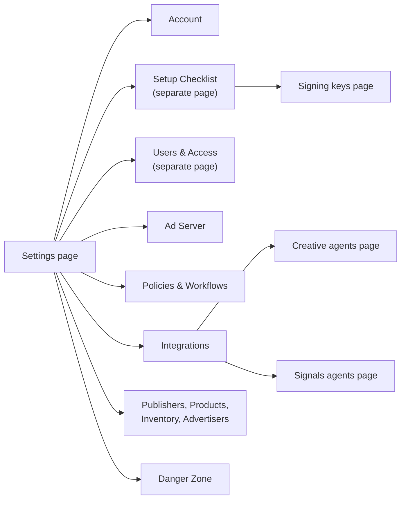

# Tenant settings

The **Settings** page holds the configuration of one tenant: its name and
address, its ad server, its business rules, and its integrations. This guide
describes each section, what the fields change, and what the page does not do.

Open the page at `/tenant/<tenant_id>/settings`, or click **Settings** under
**Operations** on the dashboard.

## The sections of the page

The navigation on the left side of the page lists the sections. Two entries
open a separate page instead of a section.

The following table shows where each task is described.

| Section | What you set there | Described in |
|---------|--------------------|--------------|
| **Account** | Name, custom domain, favicon, authorized domains and emails | [Account](#account) |
| **Setup Checklist** | Nothing; the page reports what is missing | [Setup checklist](#setup-checklist) |
| **Users & Access** | Users, allowed domains, setup mode, SSO | [Users and access](#users-and-access) |
| **Ad Server** | The ad server and its connection | [Ad server](#ad-server) |
| **Policies & Workflows** | Budgets, naming, approvals, creative review, policy checks | [Policies and workflows](#policies-and-workflows) |
| **Integrations** | Slack, AI services, creative agents, signals agents | [Integrations](#integrations) |
| **Publishers**, **Products**, **Inventory**, **Advertisers** | Shortcuts to the pages of those areas | [Shortcut sections](#shortcut-sections) |
| **Danger Zone** | Deactivation of the tenant | [Danger zone](#danger-zone) |

Each section saves on its own. A button such as **Save Account Settings**
saves only the form that contains it.

## Account

The **Account** section sets the identity of the tenant.

### Change the name or the custom domain

1. In **Organization Name**, enter the name of the tenant.
2. In **Custom Domain**, enter the host that serves this tenant, for example
   `sales-agent.yourcompany.com`.
3. Click **Save Account Settings**.

Both fields are required. The custom domain is the tenant's virtual host: the
application matches the `Host` of each request against it to find the tenant.
A change of this field therefore changes the address that buyers and
operators use.

The application refuses a save in the following cases.

| Message | Cause | Fix |
|---------|-------|-----|
| `Tenant name is required` | **Organization Name** is empty | Enter a name |
| `Virtual host is required — it is the address this tenant is served at` | **Custom Domain** is empty | Enter a host |
| `This virtual host is already in use by another tenant` | Another tenant declares the same host | Enter a different host |

The application also refuses a value that is not a bare host with an optional
port, such as a value that contains a scheme or a path.

In a multi-tenant deployment the section also shows **Subdomain**. The field
is read-only, and saving the form does not change it.

### Set the favicon

Under **Branding**, the **Favicon** area accepts an ICO, PNG, or SVG file of
at most 1 MB, or a URL.

- To upload a file, choose the file and click **Upload**.
- To use a hosted file, enter the address under **Or provide a URL** and click
  **Save URL**. The address must start with `http://` or `https://`.
- To return to the default favicon, click **Remove**.

### Register the custom domain

A multi-tenant deployment that uses Approximated for custom domains shows two
more boxes in this section:

- **Configure DNS Records** shows the DNS record that points your domain at
  the proxy.
- **Domain Registration Status** has the buttons **Check Status**,
  **Register Domain**, and **Unregister Domain**.

After you register a domain, wait one to two minutes for the TLS certificate.
A single-tenant deployment does not show these boxes.

### Control who can sign in

Under **Access Control**, two lists decide which people can sign in to this
tenant with the deployment's OAuth sign-in:

- **Authorized Domains** admits every address of an email domain. Enter the
  domain, for example `company.com`, and click **Add Domain**.
- **Authorized Emails** admits one address. Enter the address and click
  **Add Email**.

Click **Remove** next to an entry to delete it.

A tenant that signs in with its own SSO provider reads the domain list but
not the email list. See
[Admin UI authentication and permissions](../development/admin-ui-authentication.md)
for the exact rules.

## Setup checklist

The **Setup Checklist** page at `/tenant/<tenant_id>/setup-checklist` reports
what the tenant still needs. It groups tasks under **Critical Tasks**,
**Recommended Tasks**, and **Optional Enhancements**. An incomplete task shows
a **Configure** link to the place where you complete it.

The critical tasks matter most: while one of them is incomplete, the tenant
refuses a buyer's request to create a media buy. The buyer receives a
configuration error that names the missing tasks. A request for a sandbox
account skips the tasks that concern the real ad server.

| Critical task | Complete when | Where to complete it |
|---------------|---------------|----------------------|
| **Ad Server Configuration** | An ad server is selected | [Ad server](#ad-server) |
| **Single Sign-On (SSO)** | SSO is enabled and setup mode is off (single-tenant deployments only) | [Users and access](#users-and-access) |
| **Currency Configuration** | At least one currency has limits | [Budget controls](#budget-controls) |
| **Authorized Properties** | At least one authorized property exists | [Publishers and authorized properties](publishers.md) |
| **Inventory Sync** | Synced inventory exists (Google Ad Manager tenants only) | [Inventory and inventory profiles](inventory.md) |
| **Products** | At least one product exists | [Products](products.md) |
| **Advertisers (Principals)** | At least one advertiser exists | [Advertisers](advertisers.md) |

The Mock ad server completes **Ad Server Configuration** only in a testing
deployment. For a tenant that does not use Google Ad Manager, the inventory
task is named **Inventory Configuration** and is always complete.

The recommended tasks are **Account Name**, **Creative Approval Guidelines**,
**Naming Conventions**, **Budget Controls**, **AXE Segment Keys**,
**Slack Integration**, and **Custom Domain (CNAME)**. The optional tasks are
**Single Sign-On (SSO)** in a multi-tenant deployment,
**Signals Discovery Agent**, **Gemini AI Features**, **Message Signing Key**,
and **Multiple Currencies**.

The application caches the checklist for five minutes, so a task can stay
incomplete for a short time after you fix it.

## Users and access

The **Users & Access** page at `/tenant/<tenant_id>/users` lists the people
who can sign in to the tenant and holds the SSO configuration.

### Add or deactivate a user

1. Under **Add User**, enter the person's address in **Email Address**.
2. In **Role**, select the user's role. The list starts at **Viewer**.
3. Click **Add User**.

The **Users** table shows each user's name, role, status, and last login. To
change a role, select it in the user's row and click **Change**. Click
**Deactivate** to stop a user from signing in, and **Activate** to reverse
that. The page has no button that deletes a user.

### Allow a whole email domain

Under **Allowed Domains**, enter a domain and click **Add Domain**. Click the
**×** next to a domain to remove it. This list is the same list as
**Authorized Domains** in the **Account** section.

### Configure SSO and leave setup mode

The **Single Sign-On (SSO)** card configures the tenant's own identity
provider. [Single sign-on (SSO) setup](sso-setup.md) describes the fields and
the provider-specific steps.

A tenant starts in setup mode, and the page shows **Setup Mode Active**. After
you configure SSO and sign in through it, click **Disable Setup Mode**. The
page then shows **Production Mode** and a **Re-enable Setup Mode** button.

The application refuses to turn off setup mode unless SSO is enabled and you
signed in through SSO in the current session.

### Roles

The following roles decide what a tenant user can do:

- **Viewer** - Opens pages and changes nothing.
- **Manager** - Changes settings, products, and campaigns, but cannot use the
  admin-only actions.
- **Admin** - Also manages users and roles, allowed domains and emails, setup
  mode, SSO, and the deactivation of the tenant.

Only an admin can use the controls of this page. The page refuses to demote
or deactivate the tenant's last active admin. Someone who signs in from an
allowed domain or email without an invitation becomes an admin.

## Ad server

The **Ad Server** section selects the ad server that receives the tenant's
media buys. The status line at the top shows either
**Connected to** and the name of the ad server, or **No Ad Server Connected**.

### Select an ad server

Under **Available Ad Servers**, click one of the cards **Mock (Testing)**,
**Google Ad Manager**, **Kevel**, **Broadstreet Ads**, or **Triton Digital**.
The page saves the choice and reloads without asking for confirmation. The
card of the active ad server shows the badge **Current**.

The following table shows what the section offers for each ad server.

| Ad server | Connection form | Notes |
|-----------|-----------------|-------|
| Google Ad Manager | OAuth or service account, plus the network code | See [Connect Google Ad Manager](#connect-google-ad-manager) |
| Broadstreet Ads | **Network ID**, **API Key**, **Default Advertiser ID**, **Require Manual Approval** | **Test Connection** checks the credentials |
| Mock (Testing) | **Require Manual Approval** | **Save Configuration** does not store the value |
| Kevel | None | The section shows no fields |
| Triton Digital | None | The section shows no fields |

The forms for Mock and Broadstreet do not show the saved values again when
you reopen the page.

### Connect Google Ad Manager

The Google Ad Manager form offers two ways to authenticate.

With OAuth:

1. Under **Step 1: Get OAuth Token**, click **Get OAuth Token** and complete
   the Google consent screen.
2. Under **Step 2: Configure Network Code**, click **Auto-detect Network**, or
   enter the network code yourself.
3. Click **Save Configuration**.
4. Click **Test Connection**.

OAuth needs the environment variables `GAM_OAUTH_CLIENT_ID` and
`GAM_OAUTH_CLIENT_SECRET`. Without them, the form shows
**OAuth Not Configured**.

With a service account, the form depends on the deployment. A multi-tenant
deployment shows **Create Service Account**, and then asks for the network
code. A single-tenant deployment asks for **Service Account JSON Key** and
**GAM Network Code**.
[Service account setup](../adapters/gam/service-account-setup.md) describes
the steps in Google Cloud and in Google Ad Manager.

When you save the configuration with a detected network currency and the
tenant has no limits for that currency, the application creates them. After
the connection works, sync the inventory as described in
[Inventory and inventory profiles](inventory.md).

## Policies and workflows

The **Policies & Workflows** section is one form. **Save Business Rules**
saves every part of it, and **Reset** discards your unsaved changes.

### Budget controls

**Budget Controls** lists the currencies that the tenant accepts. Each
currency has a **Min Package Budget** and a **Max Daily Package Spend**. Click
**Add Currency** to add one, and enter its three-letter code.

A buyer can create a media buy only in a currency that this list contains. The
form refuses a minimum budget that exceeds the maximum daily spend.

### Brand manifest policy

**Brand Context Requirement** decides what a buyer must provide to see
products. The following table lists the choices.

| Choice | Authentication | Brand information |
|--------|----------------|-------------------|
| **Require Authentication** (the default) | Required | Optional |
| **Require Authentication + Brand Manifest** | Required | Required |
| **Public** | Not required; products show no pricing | Optional |

### Naming conventions

**Order Name Template** and **Line Item Name Template** build the names of
the orders and line items that the tenant creates in the ad server. A
template is text with variables in braces, such as
`{order_name} - {product_name}`. The form refuses an empty template and a
template with unbalanced braces.

### Measurement providers

**Measurement Providers** lists the providers that product forms offer. Click
**Add Provider** to add a name. A tenant that does not use Google Ad Manager
needs at least one provider.

### Approval workflow

**Require manual approval for order activation** makes every media buy wait
for an operator. The option is on by default.
[Media buys, approvals, and workflows](media-buys.md) describes how you
approve or reject a waiting media buy.

### Creative review

**Creative Approval Mode** selects how the tenant reviews creatives:
**Auto-approve all creatives**, **Require human approval** (the default), or
**AI-powered review**. [Creatives](creatives.md) describes each mode and the
review page.

The AI mode needs an AI provider under [Integrations](#integrations).

### Advertising policy

**Enable automated advertising policy checks** turns on a check of each
buyer's brief against the rules that you enter in the text areas of this
part. The option is off by default, and it needs an AI provider under
[Integrations](#integrations). Without a provider, the check allows every
request.

### Product ranking

**AI Ranking Prompt** tells the AI provider how to order products for a
buyer's brief. An empty prompt turns ranking off.

## Integrations

The **Integrations** section connects the tenant to outside services.

### Slack

1. In **Task Notifications Webhook URL**, enter a Slack incoming-webhook URL.
2. Optional: In **Audit Log Webhook URL (Optional)**, enter a second URL for
   audit events.
3. Click **Save Slack Settings**.
4. Click **Test Connection**.

**Test Connection** sends a message to the saved task webhook. It does not
read the field, so save before you test. It does not test the audit webhook.

To turn off Slack notifications, clear both fields and save.

### AI services

**AI Services** sets the provider that AI creative review, policy checks, and
product ranking use.

1. In **AI Provider**, select a provider.
2. In **Model**, select a model.
3. In **API Key**, enter the provider's key.
4. Click **Save AI Settings**.
5. Click **Test AI Connection**.

Leave **API Key** blank to keep the stored key. The optional
**Logfire Token (Optional)** field sends AI traces to Logfire, and
**Test Logfire** checks the token.

### Creative agents and signals agents

**Manage Creative Agents** opens the page at
`/tenant/<tenant_id>/creative-agents/`. The page turns the standard creative
agent on or off, and lists the custom creative agents of the tenant. Use
**Add Creative Agent** to add an agent, and **Test**, **Edit**, or **Delete**
on a row.

**Manage Signals Agents** opens the page at
`/tenant/<tenant_id>/signals-agents/`, which lists signals discovery agents
with the same row actions.

## Shortcut sections

Four sections of the page link to other areas instead of holding settings.
The following table shows where each one leads.

| Section | What it shows | Guide |
|---------|---------------|-------|
| **Products** | Links to the product list and the form that adds a product | [Products](products.md) |
| **Advertisers** | The advertisers and a link that creates one | [Advertisers](advertisers.md) |
| **Inventory** | The sync status and sync buttons of a Google Ad Manager tenant | [Inventory and inventory profiles](inventory.md) |
| **Publishers** | An earlier publisher list that does not show the stored state | [Publishers and authorized properties](publishers.md) |

Manage publishers on the **Publishers & Properties** tab that the publishers
guide describes, not in the **Publishers** section of this page.

## Signing keys

The **Signing Keys** page at `/tenant/<tenant_id>/signing-keys/` holds the
keys that sign the tenant's outbound messages. No section of the
**Settings** page links to it. Open it from the **Message Signing Key** task
on the setup checklist, or enter the address.

- To create a key, select an **Algorithm** and click **Provision Key**. The
  application publishes the key immediately.
- To retire a key, click **Revoke** on its row.

The [signing key runbook](../operations/signing-key-runbook.md) describes
rotation and what a revocation changes for the receivers of your messages.

## Buyer accounts

The **Accounts** page at `/tenant/<tenant_id>/accounts/` lists the buyer
accounts of the tenant. No other page links to it, so enter the address.

- Click **New Account** to create an account. The application creates it with
  the status `active`.
- Open an account to edit its name, billing model, payment terms, and rate
  card.
- Use the status buttons on the account page to change the status.

The following table lists the status changes that the page offers.

| Status | Can change to | Notes |
|--------|---------------|-------|
| `active` | `suspended`, `closed` | |
| `pending_approval` | `active`, `rejected` | |
| `rejected` | `pending_approval` | |
| `payment_required` | `active`, `suspended` | |
| `suspended` | `active`, `closed` | |
| `closed` | Nothing | The status is final |

## Danger zone

A multi-tenant deployment shows the **Danger Zone** section. It deactivates
the tenant.

1. In the confirmation field, type the name of the tenant exactly as the page
   shows it.
2. Click **Deactivate Sales Agent**.

The application marks the tenant inactive, records the action in the audit
log, signs you out, and removes the tenant from the tenant list. It keeps
all data.

The page has no button that reactivates a tenant. A super admin reactivates
it with a `POST` request to `/admin/tenant/<tenant_id>/reactivate`.

## Pages for super admins

A super admin sees pages that cover the whole deployment:

- The tenant list at the root of the Admin UI shows every active tenant, with
  filters for configuration and activity. Click **Manage** to open a tenant.
- **Create New Account** at `/create_tenant` creates a tenant. The form
  requires **Publisher Name**, **Virtual Host**, and
  **Authorized Email Addresses**. The application adds your own address to
  the authorized emails.
- **Tenant Management Settings** at `/settings` shows whether the deployment
  has the Google Ad Manager OAuth variables. The page is read-only.

To create tenants from a script, use the Tenant Management API that
[Tenant Management API and Inventory Sync API](../operations/admin-apis.md)
describes.

## Limitations

The page has the following limits:

- The **Auto-Approve Threshold**, **Auto-Reject Threshold**, and
  **Always Require Human Review For** fields of AI creative review save a
  value that the reviewer does not read.
- The **Kevel** and **Triton Digital** cards have no connection form.
- The Mock form's **Save Configuration** button does not store its value.
- The naming presets insert the variable `{buyer_ref}`, which the templates
  do not replace.
- The **Gemini AI Features** checklist task does not read the provider that
  you configure under **AI Services**.

## Related documentation

- [Single sign-on (SSO) setup](sso-setup.md)
- [Publishers and authorized properties](publishers.md)
- [Inventory and inventory profiles](inventory.md)
- [Media buys, approvals, and workflows](media-buys.md)
- [Creatives](creatives.md)
- [Environment variables](../deployment/environment-variables.md)
- [Admin UI authentication and permissions](../development/admin-ui-authentication.md)
